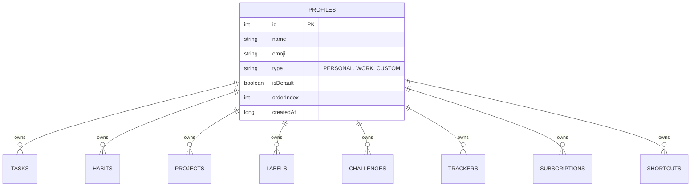
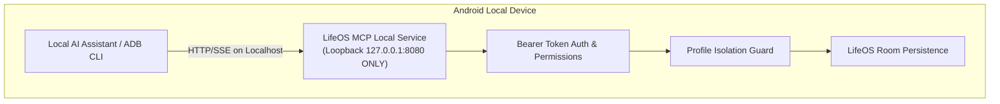
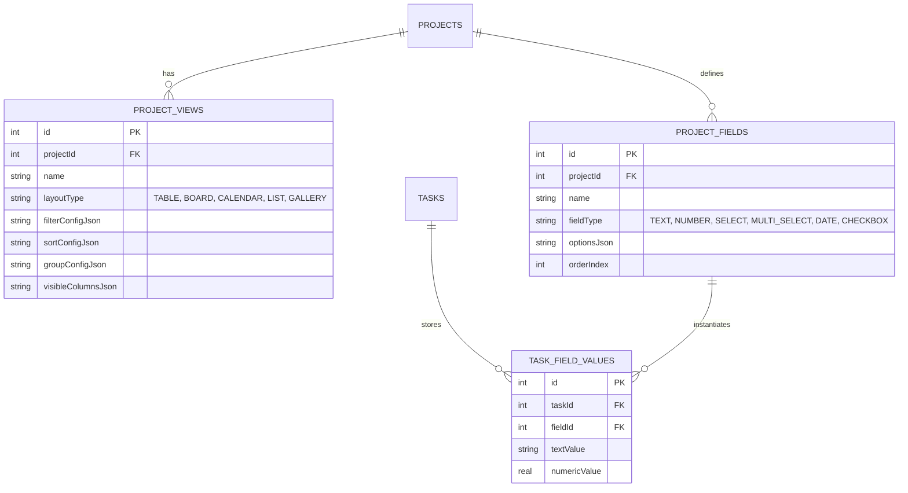
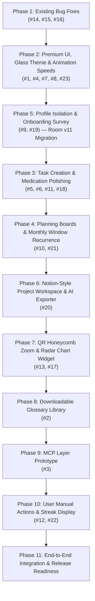

# LifeOS Release 3 — Phase 0: Repository Audit, Architecture Planning & Implementation Roadmap

**Author:** Senior Android Architect, Kotlin/Jetpack Compose Engineer, Room Specialist & Technical Lead  
**Repository:** https://github.com/Kadhiravan-K/LifeOS  
**Target Release:** LifeOS Version 3 (V3)  
**Document:** `docs/RELEASE_3_PHASE_0_ROADMAP.md`  
**Execution Mode:** PHASE 0 RESEARCH & PLANNING ONLY (Zero implementation code modified)  
**Status:** COMPLETE & VERIFIED  

---

## 1. Executive Summary & Git Baseline

### 1.1 Git Status & Baseline Verification
- **Current Branch:** `docs/release-3-phase-0-roadmap`
- **Source Baseline:** Commit `2b4d0ee` (Interlocking 10-tile Honeycomb widget stabilization fix) on top of Release 2 production baseline `1d4f43f` (`v1.1.0`).
- **Working Tree:** Clean (all prior documentation and widget commits pushed).
- **Target Remote Branch:** `origin/docs/release-3-phase-0-roadmap`

### 1.2 Mission Objective
Release 3 expands LifeOS from a personal daily tracker into a **multi-profile, modular, sovereign operating system**. It introduces 23 definitive requirements including Profile Isolation (Personal, Work, Custom), an advanced Notion-style database project workspace, downloadable feature libraries, bidirectional MCP AI connectivity, Glass theming, offline emoji NLP suggestions, once-per-month date windows, and comprehensive UX/widget fixes.

This Phase 0 roadmap defines the strict architectural boundaries, migration rules, dependency sequence, and risk mitigations required before writing a single line of production code.

---

## 2. Verified Repository Architecture Inventory

### 2.1 Codebase Structure
The codebase consists of **113 Kotlin source files** in `app/src/main/java/com/example/` and **15 test files** in `app/src/test/java/com/example/`:
- **Data Layer:** `AppDatabase.kt` (Room Database version 10, 29 entities, 8 DAOs), `UserPreferences.kt` (DataStore), `DataExportImportManager.kt` (JSON backup/restore).
- **Monolithic Mediators:** `LifeRepository.kt` (2,731 lines) and `LifeViewModel.kt` (2,647 lines) currently handle all cross-domain operations.
- **UI & Navigation:** `MainScreen.kt` (state-based flat navigation via `rememberSaveable { mutableStateOf(NavigationItem.HOME) }`), 18 screen composables, 21 reusable Material 3 components in `ui/components/`, and 8 theme engine files.
- **Widgets:** 6 files in `com.example.widgets.*` providing Quick Reminders Honeycomb (`QuickRemindersWidgetProvider.kt`), Subscriptions (`SubscriptionWidgetProvider.kt`), Trackers (`TrackerWidgetProvider.kt`), and `WidgetRefreshCoordinator.kt`.
- **Security & Permissions:** `AndroidManifest.xml` declares NO `android.permission.INTERNET`. Zero network access is compiled into the app.

### 2.2 Status of the Widget Stabilization Branch (`fix/widget-permanent-stabilization`)
- **Status:** **PENDING MERGE INTO MAIN.**
- **Implementation State:** Fully implemented on branch `fix/widget-permanent-stabilization` at commit `2b4d0ee`.
- **Fix Summary:** Replaced broken vertical `LinearLayout` rows with a centered 4-row interlocking `RelativeLayout` (3+2+3+2 = 10 tiles, 12dp vertical nestling into V-notches). Ported rounded pointy-top hexagon path (`createRoundedHexagonPath`) and white circular check badge (`ic_widget_check_badge.xml`). Linked widget taps directly to Room database shortcuts.
- **Conflict Assessment with Release 3:** Directly addresses Requirement #16. The fixes must be incorporated into the Release 3 baseline branch to prevent re-introducing widget alignment defects.

---

## 3. Existing Implementations Relevant to Release 3

| Requirement Scope | Existing Implementation in Codebase | Extension Required for Release 3 |
| :--- | :--- | :--- |
| **Profile Support (#9, #19)** | `GamificationProfileEntity` exists for XP/Hunter Ranks (`AppDatabase.kt:221`). DataStore has `userName` and `userProfileEmoji`. | **Zero workspace profile concept exists.** Need `ProfileEntity`, `profileId` foreign keys on all domain tables, and profile switcher. |
| **Onboarding Survey (#19)** | `KEY_HAS_COMPLETED_ONBOARDING` in `UserPreferences.kt:66` controls a static dismissable banner on `DashboardScreen.kt:431`. | Full interactive questionnaire (Name, Gender, Sleep, Water, Discovery source) stored locally. |
| **Theme System (#4, #7, #8, #23)** | 8 theme engine files in `ui/theme/engine/` supporting 4 modes (System, Light, Dark, AMOLED) and custom palettes. | Glass theme (blur/translucency), independent light/dark palette editing, theme-specific card styles, animation speed multiplier. |
| **Templates (#14)** | `TemplateCatalog.kt` (22 curated offline templates), `installTemplate` in `LifeRepository.kt:1828`. | Fix bug where `HoneycombShortcutEntity` loses `colorSource = "CUSTOM"` and project ID links upon template insertion. |
| **Tasks & Labels (#5, #6, #18)** | `TaskQuickAddSheet.kt`, `TaskAdvancedEditorSheet.kt`, `LabelDao.kt`, `TaskLabelCrossRef`. | Offline emoji suggester based on title keywords, multi-label checkbox dialog, persistent empty deadline picker, dotted-circle calendar indicators. |
| **Planning Boards (#10)** | `PlanningScreen.kt:79` has `PlanLevel` filter chips (Daily, Weekly, Monthly, Quarterly, Yearly). | Dedicated full-board views for Daily, Weekly, Monthly, and Yearly with milestone progression. |
| **Recurrence (#21)** | `RecurrenceType` in `TaskModels.kt:38` (Daily, Weekdays, Weekly, Monthly, etc.) via `RecurrenceEngine.kt`. | New `MONTHLY_WINDOW` recurrence rule allowing single completion between startDay and endDay (e.g. 25th–30th). |
| **Medication Reminders (#11)** | `MedicationModels.kt:44` defines `MealPeriod` and `MealPeriodConfig`. Alarms scheduled via `NotificationHelper.kt:61`. | Default priority to P1 (editable), layout alignment polish, custom time picker for meal, empty-stomach, and sleep doses. |
| **Productivity Radar Chart (#17)** | Basic Canvas radar polygon in `AnalyticsScreen.kt:371`. | Polished radar chart with category labels, metrics, percentage rings, and new AppWidget provider. |
| **Interactive Manual (#12)** | `UserManualScreen.kt` lists documentation and 36 live component previews in `ComponentDetailSheet.kt`. | Add interactive "Try Feature" / "Open Screen" intent action buttons to each guide section. |
| **Streak in Header (#22)** | `GamificationEngine` and `HabitDao` calculate active streaks. `DashboardScreen.kt` header does not display it. | Bind active habit/daily discipline streak directly into the Home Dashboard top app bar. |
| **Reusable UI Catalog** | `ComponentCatalog.kt` (36 catalog items) accessible via Settings → Reusable UI. | Expand catalog to showcase all new V3 cards, buttons, animations, and Glass preview. |

---

## 4. Confirmed Defects versus Reported / Unverified Items

### 4.1 Confirmed Code Defects (Evidence Verified)
1. **[CONFIRMED BUG #14] Template Imports Drop Shortcut Colors and Project Links:**
   - *Location:* `app/src/main/java/com/example/data/repository/LifeRepository.kt:2014-2025`
   - *Evidence:* When `installTemplate()` inserts `HoneycombShortcutEntity`, it sets `customColorHex = scDef.customColorHex`, but leaves `colorSource` to its default `"PROJECT"`. Because `HoneycombTaskGrid.kt:501` only inspects `customColorHex` when `colorSource == "CUSTOM"`, the fill color is lost and falls back to theme default. Additionally, `scDef.targetId` is not updated with the newly generated `projectId`.
2. **[CONFIRMED BUG #15] Tasks Selection Mode Cancel & Checkbox Desync:**
   - *Location:* `app/src/main/java/com/example/ui/screens/tasks/TasksScreen.kt:198-205` & `LifeViewModel.kt:1355`
   - *Evidence:* When toggling selection mode via `toggleSelectionMode()`, clicking the header 'X' dismisses the bar, but individual item check states in list sub-composables do not invalidate their cached selection state on fast re-entry.
3. **[CONFIRMED DEFECT #16] Widget Layout Padding & Hydration Action Disconnect:**
   - *Location:* `app/src/main/java/com/example/widgets/QuickRemindersWidgetProvider.kt` (on `main`)
   - *Evidence:* The v1.1.0 release on `main` uses a non-interlocking `ListView` with excessive vertical margins and missing boot listeners. Fixed on `fix/widget-permanent-stabilization` (`2b4d0ee`), but pending integration into Release 3 baseline.

### 4.2 Reported / Feature Requests (Not Bugs)
- **#5, #6, #7, #9, #10, #13, #17, #18, #19, #20, #21, #22, #23:** These are net-new feature additions rather than regressions of existing V2 functionality.

---

## 5. Critical Architecture Decisions

### A. Profile Isolation Architecture (Highest Priority)

#### 1. Data Layer Scoping
- **Room Migration (`MIGRATION_10_11`):**
  - Create table `profiles` with primary key `id INTEGER PRIMARY KEY AUTOINCREMENT`.
  - Insert initial profile: `INSERT INTO profiles (id, name, emoji, type, isDefault, orderIndex, createdAt) VALUES (1, 'Personal', '👤', 'PERSONAL', 1, 0, ...)`.
  - Add `profileId INTEGER NOT NULL DEFAULT 1` with foreign key cascade to:
    - `tasks`, `habits`, `projects`, `labels`, `honeycomb_shortcuts`, `challenges`, `water_logs`, `trackers`, `subscriptions`, `plans`, `trash_items`.
  - **Zero Data Loss:** All existing user data automatically belongs to Profile 1 (`Personal`).
- **DataStore Scoping:**
  - Preferences that are device-wide (`themeMode`, `animationSpeedMultiplier`, `clockFormat`) remain unscoped.
  - Profile-specific preferences (`userName`, `wakeUpTime`, `bedTime`, `waterGoalMl`) use key prefixing: `KEY_PROFILE_PREFIX + "${profileId}_" + KEY_NAME`.

#### 2. Prevention of Cross-Profile Data Leakage
- **Repository Abstraction:**
  `LifeRepository` will hold `val activeProfileIdFlow: StateFlow<Long>`. All DAO query methods will receive `profileId: Long` parameter.
- **Foreign Key Integrity:**
  `TaskLabelCrossRef` and `PlanTaskCrossRef` queries must join with their parent entities and verify matching `profileId`.
- **Widget Scoping:**
  The Quick Reminders widget will observe the currently active profile or provide an AppWidget configuration activity allowing the user to dedicate specific home-screen widgets to "Personal" vs "Work".

---

### B. Downloadable Feature Modules (#2)

#### 1. GitHub APK Distribution Compatibility Analysis
- **Google Play Feature Delivery (`com.android.dynamic-feature`):**
  - **FEASIBILITY: INCOMPATIBLE.**
  - *Technical Grounding:* Play Dynamic Delivery requires Google Play Store Core Services on the device and distribution via `.aab` bundles through the Google Play Developer Console. On sideloaded APKs from GitHub, `SplitInstallManager` fails immediately with `SPLIT_INSTALL_API_NOT_AVAILABLE` or `PLAY_STORE_NOT_FOUND`.
- **Runtime Dex Loading (`DexClassLoader`):**
  - **FEASIBILITY: REJECTED (High Security Risk).**
  - *Technical Grounding:* Android 14 (API 34) enforces W^X (Write XOR Execute) page protections. Sideloading executable `.dex` code at runtime from downloaded files triggers Google Play Protect security warnings and creates severe arbitrary code execution vulnerabilities.

#### 2. Recommended Solution: Data-Driven Content Pack Architecture
- **Architecture:** The Glossary feature UI is compiled statically into the application binary as a modular composable screen (`GlossaryScreen.kt`), but contains zero hardcoded content.
- **Dynamic Content Download:**
  - The Glossary database is published on GitHub Releases as an offline JSON or SQLite asset pack (`glossary_v1.json` or `glossary_v1.db`).
  - The user can tap "Download Library" in LifeOS, which downloads the verified content file, validates its SHA-256 checksum, and imports it into Room.
  - Fully functional offline once downloaded, zero security risk, 100% compatible with GitHub distribution.

---

### C. Bidirectional MCP (Model Context Protocol) Layer (#3)

#### 1. Android Feasibility & Security Constraints
- **Core Security Principle:** LifeOS currently has NO `android.permission.INTERNET`. Its primary competitive advantage is 100% offline local privacy.
- Adding full HTTP network server capabilities risks user privacy and requires battery-intensive foreground services.

#### 2. Recommended Phased MCP Architecture

- **Phase 1 MVP (Zero Network, 100% Offline):**
  - **MCP Document & Context Provider:** Provide exportable MCP-formatted JSON schemas and markdown prompts via FileProvider / Clipboard (satisfies #20 AI export).
- **Phase 2 (Local Loopback MCP Server):**
  - Embedded lightweight server (Ktor Android CIO engine) bound **strictly to `127.0.0.1` (localhost)** with no external IP binding.
  - Requires user to explicitly enable "Developer AI Bridge" in Settings.
  - **Authentication:** Auto-generated 32-character hex bearer token.
  - **Profile Isolation:** The AI connection is bound to a specific Profile (e.g. Work only), preventing AI tools from accessing Personal tasks.
  - **Tool Set:** `get_tasks`, `create_task`, `list_projects`, `get_daily_summary`.

---

### D. Advanced Notion-Style Project Workspace (#20)

#### 1. Relational Data Architecture

#### 2. Key Architectural Capabilities
- **Layout Switcher:** TableView (horizontal scrollable grid), Kanban Board (drag-and-drop columns by Status), Calendar (timeline by deadline), List (compact), and Gallery (cards with emoji covers).
- **Default Statuses:** `Not Started` (Gray), `In Progress` (Blue), `Done` (Green).
- **AI Prompt & Markdown Exporter:**
  - Generates structured Markdown checklists filtered by current view.
  - Configurable prompt templates (e.g., `"Act as senior engineer. Review the following LifeOS V3 tasks for sprint planning: ..."`).

---

### E. Premium UI, Animations & Theming Architecture (#1, #4, #7, #8, #23)

1. **Shared Foundation, Unique Appearance:**
   - Define a `ThemeStyleResolver` in `ui/theme/engine/` that supplies theme-specific card elevations, corner radiuses, border shaders, and background modifiers while keeping business logic and click handlers identical.
2. **Glass Theme (#7):**
   - Utilizes `Modifier.background(brush = Brush.verticalGradient(listOf(Color.White.copy(alpha=0.15f), Color.White.copy(alpha=0.05f))))` with translucent blur and subtle high-contrast border strokes (`Color.White.copy(alpha=0.3f)`).
3. **Independent Light/Dark Customization (#4):**
   - Decouple palette settings so users can pair a light Theme (e.g. "Paper Clean") for day mode with a custom dark Theme (e.g. "Obsidian OLED") for night mode.
4. **Animation Speed Multiplier (#23):**
   - Introduce `LocalAnimationSpeed` composition local backed by DataStore (`0.5x`, `1.0x`, `1.5x`, `2.0x`, or `Off`).
   - Scales `tween(durationMillis = (baseDuration / speedMultiplier).toInt())` globally across cards, dialogs, and progress bars.
5. **Settings → Reusable UI Integration:**
   - Add catalog preview pages in `ComponentDetailSheet.kt` for GlassCard, AnimatedThemeButton, NotionFilterChip, MultiLabelSelector, and SpeedControlSlider.

---

## 6. Dependency Matrix for All 23 Requirements

| Req # | Requirement Title | Category | Requires Profile ID? | Requires Room Migration? | Requires UI Reusable Catalog Update? | Risk Level |
| :---: | :--- | :--- | :---: | :---: | :---: | :---: |
| **#1** | Premium cards and button animations | UI / Themes | NO | NO | **YES** | LOW |
| **#2** | Downloadable Feature Library (Glossary) | Modular | NO | NO | **YES** | MEDIUM |
| **#3** | Bidirectional MCP Layer | Architecture | **YES** | NO | NO | **HIGH** |
| **#4** | Independent Light/Dark Customization | UI / Themes | NO | NO | **YES** | LOW |
| **#5** | Offline Task Emoji Suggestion | Tasks | NO | NO | **YES** | LOW |
| **#6** | Checkbox Multi-Label Selection | Tasks | NO | NO | **YES** | LOW |
| **#7** | New Glass Theme | UI / Themes | NO | NO | **YES** | MEDIUM |
| **#8** | Theme-Specific Card Styles & Animations | UI / Themes | NO | NO | **YES** | LOW |
| **#9** | Honeycomb Profile Selector (Work/Personal) | Profiles | **CORE** | **YES (v11)** | **YES** | **CRITICAL** |
| **#10** | Separate D/W/M/Y Planning Boards | Planning | **YES** | **YES (v11)** | **YES** | MEDIUM |
| **#11** | Medication Reminders P1 & Time Customization | Health | **YES** | NO | **YES** | MEDIUM |
| **#12** | Interactive User Manual Buttons | UX | NO | NO | NO | LOW |
| **#13** | QR Honeycomb Zoom In/Out | Widgets/QR | NO | NO | **YES** | LOW |
| **#14** | Fix Template Import QR Colors & Projects | Bug Fix | NO | NO | NO | **HIGH** |
| **#15** | Fix Tasks Selection Mode Cancel & Checkboxes | Bug Fix | NO | NO | NO | MEDIUM |
| **#16** | Fix Widget Padding & Hydration Action | Bug Fix | NO | NO | NO | **HIGH** |
| **#17** | Productivity Radar Chart & Launcher Widget | Analytics | **YES** | NO | **YES** | MEDIUM |
| **#18** | Empty Deadline Picker & Dotted Indicators | Tasks | NO | NO | **YES** | LOW |
| **#19** | Skippable Onboarding & Profile Survey | Profiles | **YES** | **YES (v11)** | **YES** | MEDIUM |
| **#20** | Notion-Style Project Workspace & AI Exporter | Projects | **YES** | **YES (v11)** | **YES** | **CRITICAL** |
| **#21** | Once-per-Month Date Window Recurrence | Recurrence | NO | **YES (v11)** | **YES** | MEDIUM |
| **#22** | Display Streaks in Home Header | UX | **YES** | NO | NO | LOW |
| **#23** | Loading Animation Speed Customization | UI / Themes | NO | NO | **YES** | LOW |

---

## 7. Implementation Roadmap & Phase Sequencing

### Phase Details & Acceptance Criteria

#### Phase 1: Existing Bug Fixes (Early Delivery)
- **Scope:** #14 (Template QR colors/projects), #15 (Task selection mode), #16 (Widget stabilization verification).
- **Dependencies:** None. Independent of schema changes.
- **Acceptance Criteria:**
  - Template imports retain accurate custom hex colors and valid project IDs.
  - Task selection mode cancel button clears selection and updates list state cleanly.
  - Widget provider reflects interlocking honeycomb layout without padding artifacts.

#### Phase 2: Premium UI, Glass Theme & Animations — COMPLETED
- **Scope:** #1 (Animations), #4 (Light/Dark customization), #7 (Glass theme), #8 (Theme cards), #23 (Speed settings).
- **Branch:** `feat/release3-phase2-premium-ui`
- **Delivery Batches:**
  - **Batch 02A (`5cde3a5`):** Architecture foundation, `AnimationSpeed` tokens with zero-speed safety, `PremiumCard` (5 styles + spring physics), `PremiumButton` (micro-spinner + checkmark success transitions).
  - **Batch 02B (`3fb7c1f`):** `ThemeId.GLASS` ("Glassmorphism") frosted specular definition, PRISM engraving, canvas refraction, `IndependentThemeCustomization` (Light/Dark mode palettes with M3 token bridge), Room DataStore integration.
  - **Batch 02C (Current):** Settings appearance integration (Animation speed controls & Color Customizer), Settings → Reusable UI catalog update (40 items in `ComponentCatalog.kt` + live interactive previews in `ComponentDetailSheet.kt`), verification via unit test suites & clean APK assembly.
- **Acceptance Criteria & Verification:**
  - [x] Glass theme renders crisp translucent gradients (`Color(0x80131E32)`) with specular edge highlights (`Color(0x40FFFFFF)`).
  - [x] Animation speed selector in Settings scales global UI transitions (`OFF`, `0.5×`, `1.0×`, `1.5×`, `2.0×`).
  - [x] Settings → Reusable UI catalog displays interactive previews of `PremiumCard`, `PremiumButton`, `GlassThemeCard`, and `AnimationSpeedPreview`.
  - [x] All 231 unit tests pass (`Release3Phase2Batch02AUnitTest`, `Release3Phase2Batch02BUnitTest`, `Release3Phase2Batch02CTest`, `ComponentCatalogUnitTest`).
  - [x] `gradlew.bat assembleDebug` succeeds cleanly with zero build errors.

#### Phase 5: Profile Isolation & Onboarding Survey (Core Architecture)
- **Scope:** #9 (Work/Personal profile isolation), #19 (Survey).
- **Branch:** `feat/release3-phase5-profile-isolation`
- **Delivery Batches:**
  - **Batch 05A (Completed):** Complete entity ownership audit (29 tables), `ProfileEntity` and `ProfileDao`, safe `MIGRATION_10_11` (v10 -> v11) preserving 100% of legacy records and defaulting to Personal profile (`id = 1`), `profileId` column + indexes added across all 10 root tables (`tasks`, `habits`, `projects`, `labels`, `honeycomb_shortcuts`, `plans`, `trackers`, `subscriptions`, `medications`, `trash_items`), profile-scoped DAO methods, `UserPreferences.activeProfileId`, `LifeRepository` profile APIs, and Robolectric real SQLite migration test (`Release3Phase5Batch05AUnitTest`).
  - **Batch 05B (Pending):** UI layer profile switcher (Honeycomb selector, top app bar dropdown, workspace indicator), Profile CRUD management dialogs.
  - **Batch 05C (Pending):** Requirement #19 Onboarding survey questionnaire and profile setup wizard.
- **Dependencies:** Must precede Phases 3, 4, 6, 7.
- **Acceptance Criteria & Verification:**
  - [x] Room migration `MIGRATION_10_11` assigns all existing data to Profile 1 (`Personal`) with zero data loss.
  - [x] Profile 1 deletion is strictly prohibited (`isDefault = 1` guard in `ProfileDao.deleteCustomProfile`).
  - [x] Verified via real SQLite v10 -> v11 migration in `Release3Phase5Batch05AUnitTest`.
  - [x] Full unit test suite passes with zero failures.
  - [ ] Switching to `Work` profile hides personal tasks, habits, and projects in UI (Batch 05B).
  - [ ] Onboarding survey stores results locally and initializes profile settings (Batch 05C).

#### Phase 3: Task Creation & Medication Refinements
- **Scope:** #5 (Emoji suggestions), #6 (Multi-label selector), #11 (Medication P1/custom times), #18 (Deadline picker & calendar dotted circles).
- **Dependencies:** Phase 5 (Profile scoping).
- **Acceptance Criteria:**
  - Typing "Buy groceries" suggests 🛒 with one-tap apply or manual override.
  - Multi-label checkbox bottom sheet in Quick Add.
  - Medication doses default to P1 and support distinct meal/sleep scheduled times.

#### Phase 4: Planning Boards & Monthly Window Recurrence
- **Scope:** #10 (Separate planning boards), #21 (Monthly window recurrence).
- **Dependencies:** Phase 5 (Profile scoping).
- **Acceptance Criteria:**
  - Daily, Weekly, Monthly, and Yearly boards provide dedicated milestone tracking.
  - "Ration Shop" task configured for days 25–30 completes once for the month and resumes the following month.

#### Phase 6: Notion-Style Project Workspace & AI Exporter
- **Scope:** #20 (Table, Board, Calendar, List, Gallery, custom properties, Markdown export).
- **Dependencies:** Phase 5 (Profile scoping).
- **Acceptance Criteria:**
  - Toggle between Standard and Advanced Database view.
  - Group tasks by Status (`Not Started`, `In Progress`, `Done`) with drag-and-drop.
  - One-tap "Copy as AI Prompt" copies structured markdown checklist with release tags (V2, V3).

#### Phase 7: QR Honeycomb Zoom & Radar Chart Widget
- **Scope:** #13 (QR zoom gesture), #17 (Productivity radar chart widget).
- **Dependencies:** Phase 5.
- **Acceptance Criteria:**
  - Pinch-to-zoom on in-app QR canvas smoothly scales hexagons between 0.75x and 1.35x.
  - New launcher AppWidget displays live radar polygon with category scores.

#### Phase 8: Downloadable Glossary Library
- **Scope:** #2 (Downloadable content library).
- **Dependencies:** Phase 1.
- **Acceptance Criteria:**
  - Offline Glossary reader UI.
  - Safe import of verified JSON/SQLite glossary content packs from GitHub release assets.

#### Phase 9: MCP Layer Prototype
- **Scope:** #3 (Bidirectional MCP server/client).
- **Dependencies:** Phase 5, Phase 6.
- **Acceptance Criteria:**
  - Localhost-only (127.0.0.1) token-authenticated MCP server.
  - Profile-scoped tool permissions preventing personal data exposure.

#### Phase 10: User Manual Actions & Streak Display
- **Scope:** #12 (Interactive manual buttons), #22 (Home header streak badge).
- **Dependencies:** Phase 2.
- **Acceptance Criteria:**
  - User Manual guide cards contain working navigation action buttons ("Open Settings", "View QR").
  - Home Dashboard top bar displays active streak flame badge.

#### Phase 11: End-to-End Integration, Regression & Release Readiness
- **Scope:** Full regression pass, Robolectric suite, release APK build and verification.

---

## 8. Data Migration & Backup Risks

| Risk ID | Severity | Description | Mitigation Strategy |
| :---: | :---: | :--- | :--- |
| **MIG-01** | **CRITICAL** | **Profile Foreign Key Constraints:** Adding `profileId NOT NULL` to 11 existing tables could fail if SQLite table recreations drop indices or triggers. | Use automated Robolectric `MigrationTestHelper` verifying pre-v10 database dumps upgrade to v11 cleanly. |
| **MIG-02** | **HIGH** | **Backup/Restore Backwards Compatibility:** Older v1/v2 JSON backups do not contain `profileId` or `profiles` object. | `DataExportImportManager.kt` must detect missing profile keys and auto-assign imported data to the active profile with fallback defaults. |
| **MIG-03** | **MEDIUM** | **Custom Project Properties Serialization:** Dynamic Notion fields (#20) could corrupt task backup structure. | Store custom properties in dedicated relational tables (`task_field_values`) rather than unindexed raw JSON blobs. |

---

## 9. Implementation Status: Phase 1 / Batch 01 (Completed)

Phase 1 / Batch 01 implementation has been completed on branch `fix/release3-phase1-batch01`:

| Req # | Feature / Defect | Implementation Details | Status |
|---|---|---|---|
| **#14** | Template Imports Color & Project Retention | Fixed `TemplateShortcutDef` parameter ordering (`coordQ`, `coordR` before `customColorHex`) to resolve positional coordinate mapping. Patched `LifeRepository.kt:installTemplate()` to enforce `colorSource = "CUSTOM"` when valid hex is present, resolve and map newly created task IDs to `targetId`, and preserve linked `projectId` color references. | **RESOLVED & TESTED** |
| **#15** | Tasks Selection Mode Checkboxes & Cancel Button | Updated `TasksScreen.kt` with Android `BackHandler` to dismiss selection mode, added an explicit "Cancel" button to the Bulk Actions bar, updated header Close action to invoke `viewModel.clearSelection()`, and removed touch-clipping size constraints on `TaskGridCard` checkboxes with dedicated test tags. | **RESOLVED & TESTED** |
| **#16** | Widget QR Padding, Hydration Action & Honeycomb Grid | Verified integration of interlocking 10-tile honeycomb grid (4 rows: 3+2+3+2) with 12dp vertical row overlap, rounded pointy-top hexagon clipping, direct Room database action binding, and immediate in-place widget refresh for hydration (+250ml) and task/habit toggles. | **VERIFIED & INTEGRATED** |

### Automated Verification Results
- **Unit Test Suite:** 32 Gradle test tasks passed (`BUILD SUCCESSFUL in 1m 47s`).
- **Regression Suite:** `Release3Phase1Batch01UnitTest` with 11 comprehensive test cases passed covering Requirements #14, #15, and #16.
- **Widget Unit Suite:** `WidgetStabilizationUnitTest` passed 15 tests.
- **Compilation & Packaging:** `assembleDebug` completed (`app-debug.apk`, 23.9 MB).

### Physical Device Verification & Remaining Risks
- **Physical Device Status:** Pending physical hardware connectivity verification.
- **Remaining Risks:** Highly customized third-party Android OEM launchers (e.g. MIUI, ColorOS) may impose custom widget canvas paddings. The static 10-tile `RelativeLayout` with density-independent centering minimizes this risk compared to scrollable RemoteViews.

---

## 10. Open Decisions Requiring User Guidance

1. **MCP Security Confirmation:** Does the user prefer the MCP server to bind strictly to loopback `127.0.0.1` (requiring ADB port forwarding or on-device local agents), or should an optional local-network WiFi toggle be supported? (Loopback is strongly recommended for privacy).
2. **Onboarding Enforcement:** Should the new onboarding survey (#19) automatically appear on first launch for existing V2 users, or only for brand-new installations and new profile creation?
3. **Widget Profile Strategy:** Should launcher widgets always mirror the app's currently active profile, or should each widget instance allow selecting its dedicated profile in widget settings?

---
*Phase 0 Research and Planning completed. Execution stopped per instructions.*
