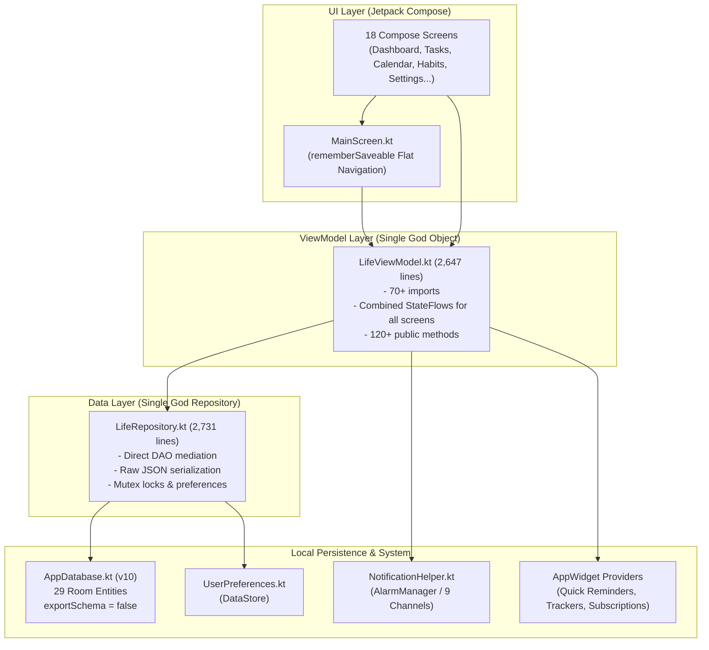
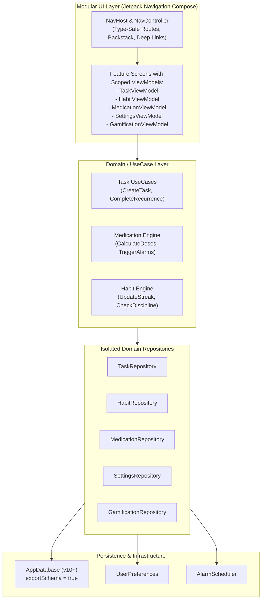
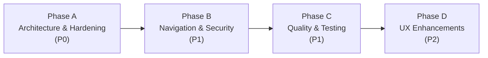

# LifeOS — Architecture Review, Codebase Audit & Release 4 Master Plan

**Author:** Principal Android Architect, Senior Kotlin Engineer & Product Strategist  
**Baseline Release:** LifeOS v1.1.0 (Release 2) — Commit `27fb90b9e19da7dbc21c453f2232bce7e416d4ed` / `1d4f43fa2c48f0a74d23f6ac02e417026c56be67`  
**Target Release:** Release 4 (Release 3 remains strictly reserved for user's standalone roadmap)  
**Deliverable Path:** `docs/claude review.md`  
**Evaluation Scope:** Codebase Audit, Security & Privacy Analysis, Market Research, Technical Debt Register, Risk Register & Strategic Product Roadmap

---

## 1. Executive Summary

LifeOS represents a unique and highly ambitious application in the Android ecosystem: a **100% offline, local-first, zero-telemetry, zero-subscription personal operating system**. Across Version 1 and Version 2, the product successfully assembled an extraordinary suite of functionality into a single package: task management with hierarchical subtasks and recurrence, habit tracking, a structured 75-Day Hard discipline engine, medication intake scheduling with critical reminder channels, consumable tracker inventory, recurring subscription expenditure auditing, Solo-Leveling-inspired Hunter Rank gamification, interactive home screen App Widgets, and a 36-component reusable frontend catalog.

However, the rapid feature velocity of early releases has accumulated severe architectural and structural debt. The entire application relies on two colossal God objects: `LifeRepository.kt` (2,731 lines) and `LifeViewModel.kt` (2,647 lines), binding over 12 distinct functional domains into monolithic shared state. Furthermore, navigation relies on a flat `rememberSaveable` enum toggle inside `MainScreen.kt` without a navigation back stack, deep linking, or route-level state preservation. In production builds, R8 minification is disabled (`isMinifyEnabled = false`), resulting in an unoptimized ~14.32 MB APK and exposed symbols. Finally, the home-screen Quick Reminders widget fix exists only on an unmerged feature branch (`fix/widget-permanent-stabilization`) and awaits physical-device verification.

The primary recommendation for **Release 4** is **Architectural Stabilization and Foundation Hardening**: decompose the God objects into isolated domain repositories and screen ViewModels, migrate to Jetpack Navigation Compose, enable R8 minification, establish a lint baseline, and harden security on exported broadcast receivers. This stabilization will preserve LifeOS's core competitive moat—complete local privacy and all-in-one integration—while enabling sustainable future growth.

---

## 2. Codebase Inventory

### 2.1 File Counts and Package Distribution
The Android client consists of **113 Kotlin source files** under `app/src/main/java/com/example/`, organized as follows:

| Package Root | File Count | Core Purpose |
| :--- | :---: | :--- |
| `data/local` | 15 | Room Database (`AppDatabase.kt`), 8 DAOs, 6 direct entity files + inline entities |
| `data/repository` | 1 | `LifeRepository.kt` (Monolithic data broker for all domains) |
| `data/preferences` | 1 | `UserPreferences.kt` (DataStore-backed key-value settings) |
| `data/backup` | 1 | `DataExportImportManager.kt` (JSON import/export and backup engine) |
| `domain/` | 24 | Domain models, recurrence engines, medication calculators, template catalog |
| `notifications/` | 2 | `NotificationHelper.kt` (9 channels, alarms), `ReminderBroadcastReceiver.kt` |
| `ui/components/` | 21 | Modular Material 3 UI component system (part of 36-catalog) |
| `ui/screens/` | 18 | Compose UI screens (Dashboard, Tasks, Calendar, Habits, Settings, etc.) |
| `ui/theme/` | 8 | Theme definitions, dynamic palette engine, custom color tokens |
| `ui/viewmodel/` | 1 | `LifeViewModel.kt` (Unified AndroidViewModel for all screens) |
| `ui/navigation/` | 3 | `MainScreen.kt`, `NavigationItem.kt`, `NavigationHelper.kt` |
| `widgets/` | 6 | AppWidget providers, RemoteViews services, coordinator, helper |
| `utils/` | 1 | `DateUtils.kt` (ISO 8601 formatting, date manipulation) |
| `root` | 2 | `MainActivity.kt`, `LifeOSApplication.kt` |
| **Total Main Sources** | **113** | **Kotlin Files** |

In addition, the test suite contains **15 Kotlin test files** under `app/src/test/java/com/example/`.

### 2.2 Largest Source Files & Complexity Risk

| Source File | Line Count | Role in System | Architectural Risk Level |
| :--- | :---: | :--- | :---: |
| `app/src/main/java/com/example/data/repository/LifeRepository.kt` | **2,731** | Monolithic Repository | **CRITICAL (P0)** |
| `app/src/main/java/com/example/ui/viewmodel/LifeViewModel.kt` | **2,647** | Monolithic ViewModel | **CRITICAL (P0)** |
| `app/src/main/java/com/example/ui/screens/settings/SettingsScreen.kt` | **2,059** | Massive Single Screen | **HIGH (P1)** |
| `app/src/main/java/com/example/domain/templates/TemplateCatalog.kt` | **1,659** | Offline Template Data | **MEDIUM (P2)** |
| `app/src/main/java/com/example/ui/screens/manual/ComponentDetailSheet.kt` | **1,499** | Component Catalog Sheet | **MEDIUM (P2)** |
| `app/src/main/java/com/example/notifications/NotificationHelper.kt` | **739** | Alarms & Notification Engine | **HIGH (P1)** |
| `app/src/main/java/com/example/data/backup/DataExportImportManager.kt` | **650** | JSON Backup & Restore | **HIGH (P1)** |
| `app/src/main/java/com/example/data/local/AppDatabase.kt` | **637** | Room DB & Migrations 1–10 | **HIGH (P1)** |

### 2.3 Dependency Analysis (`build.gradle.kts` vs `libs.versions.toml`)

#### Active Dependencies in `app/build.gradle.kts`:
- **Kotlin & Android:** Kotlin 2.2.10, AGP 9.1.1, `core-ktx:1.15.0`, `lifecycle-runtime-compose:2.8.7`
- **Jetpack Compose:** Compose BOM `2024.09.00`, Material 3, Foundation, Material Icons Extended
- **Persistence:** Room 2.7.0 (with KSP), DataStore Preferences `1.1.7`
- **Background:** WorkManager Runtime KTX `2.10.0`
- **Concurrency:** Kotlinx Coroutines Android `1.10.2`
- **Testing:** JUnit 4.13.2, Robolectric 4.16.1, Mockk 1.13.16, Turbine 1.2.0, Compose UI Test

#### [CONFIRMED] Orphaned / Dead Dependencies in `gradle/libs.versions.toml`:
The following 8 dependencies are declared in the version catalog but are **never included** in `app/build.gradle.kts`:
1. `firebase-bom` / Firebase analytics/crashlytics (Unused; app is 100% offline)
2. `retrofit` (Unused; zero networking code exists)
3. `okhttp` (Unused; zero HTTP calls executed)
4. `moshi` (Unused; parsing relies directly on `org.json.JSONObject`)
5. `coil-compose` (Unused; image loading is not integrated)
6. `camerax` (Unused; QR scanning is not present)
7. `accompanist-permissions` (Unused; native ActivityResult contracts used)
8. `play-services-location` (Unused; app has no geo-tracking)

*Code Evidence:* `gradle/libs.versions.toml:15-38` declares aliases that do not appear in `app/build.gradle.kts:80-145`.

---

## 3. Architecture Map

### 3.1 Current Architecture Diagram (Monolithic Antipattern)



### 3.2 Target Architecture Diagram (Clean MVVM + Clean Domain Repositories)



---

## 4. God Object Analysis

### 4.1 `LifeRepository.kt` (2,731 Lines)
[CONFIRMED — `app/src/main/java/com/example/data/repository/LifeRepository.kt:1-2731`]  
The `LifeRepository` acts as a monolithic mediator for every single business entity in the application. It imports 97 classes across entities, DAOs, models, and domain engines.

#### Blast Radius & Risks:
1. **Coupling:** Modifying the data flow for tasks or recurrence carries the risk of destabilizing medication doses, subscription billing, or gamification XP calculations because they share repository helper functions, mutexes, and coroutine scopes.
2. **Maintenance Bottleneck:** Concurrent work by multiple developers or subagents on different features inevitably produces severe Git merge conflicts in this single file.
3. **Embedded Business Logic:** Instead of acting strictly as a data broker, `LifeRepository` contains raw JSON string serialization (`JSONObject`), recurrence expansion algorithms, and cross-entity relational calculations.

### 4.2 `LifeViewModel.kt` (2,647 Lines)
[CONFIRMED — `app/src/main/java/com/example/ui/viewmodel/LifeViewModel.kt:1-2647`]  
`LifeViewModel` is the sole `AndroidViewModel` powering all 18 screens of the app. It holds more than 35 StateFlows, including:
- `dashboardUiState`, `tasksUiState`, `calendarUiState`, `habitsUiState`, `challengeState`
- `medicationUiState`, `trackersUiState`, `subscriptionsUiState`, `gamificationState`
- 15+ DataStore preference flows (`waterGoalFlow`, `themeModeFlow`, `bedTimeFlow`, `clockFormatFlow`)

#### Blast Radius & Risks:
1. **Recomposition Storms:** Because screen states are managed inside a single ViewModel, state emissions or event handling on background data (e.g., tracker inventory updates) risk triggering unnecessary UI evaluation across unrelated composables.
2. **Memory Retention:** Screen-specific temporary states (e.g., sheet dialog inputs, search filters, preview selections) remain retained in memory for the lifetime of the application process rather than being collected and scoped to individual screen lifecycles.
3. **Testing Impossibility:** Mocking or testing `LifeViewModel` requires stubbing dozens of repository flows, resulting in bloated, brittle tests that fail whenever an unrelated preference field is added.

---

## 5. Navigation Architecture Defects

[CONFIRMED — `app/src/main/java/com/example/ui/navigation/MainScreen.kt:49-65`]  
Navigation is implemented via a primitive mutable state variable:
```kotlin
var currentItem by rememberSaveable { mutableStateOf(NavigationItem.HOME) }
```

### Critical Architectural Defects:
1. **Absence of a Navigation Backstack:**  
   The back button handling is hardcoded:
   ```kotlin
   if (showThemeGallery) {
       BackHandler { viewModel.dismissThemePreview(); showThemeGallery = false }
   } else if (currentItem != NavigationItem.HOME) {
       BackHandler { currentItem = NavigationItem.HOME }
   }
   ```
   If a user navigates `Home -> Tasks -> Task Detail -> Medication -> Analytics`, pressing the Android system back button **jumps directly to Home**, completely discarding intermediate navigation history.
2. **Inability to Deep Link:**  
   App notifications and launcher widget shortcuts cannot pass parameterized target routes (e.g., `lifeos://medication/dose/42` or `lifeos://task/381`). Tapping notifications opens `MainActivity`, which unconditionally defaults to the `HOME` tab.
3. **No Screen Lifecycle Scoping:**  
   Without Jetpack `NavHost`, composables cannot take advantage of `hiltViewModel()` or scoped `viewModel()` lifecycles that clear state when a destination is popped.

---

## 6. Build Configuration Defects

[CONFIRMED — `app/build.gradle.kts:50-58`]  
```kotlin
buildTypes {
    release {
        isMinifyEnabled = false
        proguardFiles(
            getDefaultProguardFile("proguard-android-optimize.txt"),
            "proguard-rules.pro"
        )
    }
}
```

### Risks and Impact:
1. **No Code Shrinking or R8 Optimization:** LifeOS v1.1.0 release APK is **~14.32 MB**. Enabling R8 with dead-code elimination, resource shrinking, and tree shaking typically reduces Compose app sizes by 30%–45% (down to ~8–9 MB).
2. **Exposed Code & Class Identifiers:** With `isMinifyEnabled = false`, every internal class name, method, Room entity structure, and SQLite column name is stored as plain plaintext strings in the release `.dex` files.
3. **Version Catalog Rot:** 8 unused dependencies in `libs.versions.toml` (Firebase, Retrofit, OkHttp, Moshi, Coil, CameraX, Accompanist, Play Location) mislead contributors and automated dependency bots (Dependabot/Renovate) into generating spurious alerts.

---

## 7. Database Architecture

[CONFIRMED — `app/src/main/java/com/example/data/local/AppDatabase.kt:558-592`]  
- **Room Database Version:** `10`
- **Total Entities:** 29 Room entities
- **Schema Export Status:** `exportSchema = false`

### Entity Distribution:
1. **Core Productivity:** `TaskEntity`, `HabitEntity`, `ChallengeEntity`, `WaterLogEntity`, `HoneycombShortcutEntity`, `ProjectEntity`, `LabelEntity`, `TaskLabelCrossRef`, `TaskReminderEntity`
2. **Organization & Trash:** `TrashItemEntity`, `PlanEntity`, `PlanMilestoneEntity`, `PlanTaskCrossRef`
3. **Gamification:** `GamificationProfileEntity`, `XpEventEntity`, `AchievementEntity`, `RewardItemEntity`, `RewardRedemptionEntity`
4. **Health & Medication:** `MedicationEntity`, `MedicationDoseEntity`
5. **Trackers & Inventory:** `TrackerEntity`, `UsageCycleEntity`, `UsageEntryEntity`, `TrackerPurchaseEntity`, `InventoryAdjustmentEntity`
6. **Finance & Subscriptions:** `SubscriptionEntity`, `BillingOccurrenceEntity`, `SubscriptionPaymentEntity`, `PriceHistoryEntity`

### Critical Defects & Migration Risks:
1. **`exportSchema = false` [P1 Risk]:** Room cannot output historical schema JSON files into `schemas/`. Consequently, automated Room migration tests (`MigrationTestHelper`) cannot mathematically verify migration paths from v1 -> v10. Any manual typo in `db.execSQL()` within `MIGRATION_9_10` will result in fatal SQLite runtime crashes during user app updates.
2. **Cross-Reference Indexes:** Cross-reference tables (such as `TaskLabelCrossRef` and `PlanTaskCrossRef`) require compound foreign key cascade rules and covering indexes to prevent slow queries as user data scales over months.

---

## 8. Widget Architecture

[CONFIRMED — `app/src/main/AndroidManifest.xml:49-88` & Git Branch History]  
LifeOS defines three launcher widgets:
1. `QuickRemindersWidgetProvider` (`lifeos_quick_reminders_widget_info`)
2. `TrackerWidgetProvider` (`lifeos_tracker_widget_info`)
3. `SubscriptionWidgetProvider` (`lifeos_subscription_widget_info`)

### Production Status of Quick Reminders Honeycomb Widget:
- In production (`v1.1.0` on `main`), the widget layout diverged from the in-app Honeycomb grid, resulting in widely spaced rows, visual misalignment, and unwanted `Loading...` states.
- An extensive engineering fix was implemented on branch `fix/widget-permanent-stabilization` (Commit `7b27b45`), replacing the dynamic collection service with a deterministic, pre-computed 2-row honeycomb RemoteViews grid.
- **[CRITICAL RISK]:** The fix branch **has NOT been merged into `main`** and **physical device verification remains pending**. In production v1.1.0, the widget defect persists.

---

## 9. Notification & Alarm Architecture

[CONFIRMED — `app/src/main/java/com/example/notifications/NotificationHelper.kt:28-100`]  
LifeOS creates 9 discrete Android notification channels:
1. `lifeos_medicine_reminders` (Urgent / Importance High, vibration, lights)
2. `lifeos_task_reminders` (High Importance)
3. `lifeos_habit_reminders` (Default Importance)
4. `lifeos_hydration_reminders` (Default Importance)
5. `lifeos_calendar_alerts` (Default Importance)
6. `lifeos_qr_alerts` (Default Importance)
7. `lifeos_challenge_alerts` (Default Importance)
8. `lifeos_gamification_alerts` (Default Importance)
9. `lifeos_discipline_channel` (Daily Momentum)

### Permissions & Android 12+ / 14+ Risks:
- **`SCHEDULE_EXACT_ALARM`:** Declared in `AndroidManifest.xml:8`. On Android 13+ (API 33) and Android 14+ (API 34), `SCHEDULE_EXACT_ALARM` is restricted and may be denied by default or revoked by battery optimization policies. If the user revokes exact alarm capability, `alarmManager.setExactAndAllowWhileIdle()` throws a `SecurityException` unless wrapped in `alarmManager.canScheduleExactAlarms()` checks.
- **`USE_FULL_SCREEN_INTENT`:** Declared in `AndroidManifest.xml:9`. Critical medication alerts utilize full-screen intents. Starting with Android 14, apps targeting API 34+ must qualify for special use categories or request user approval via `ACTION_MANAGE_APP_USE_FULL_SCREEN_INTENT`.

---

## 10. Testing Coverage & Gaps

[CONFIRMED — `app/src/test/java/com/example/`]  
The test suite consists of 15 test files focused on regressions:
- `Batch01HomeRegressionUnitTest.kt`
- `Batch02TasksCalendarRegressionUnitTest.kt`
- `Batch03SettingsWidgetRegressionUnitTest.kt`
- `Batch04MobileTestingRegressionUnitTest.kt`
- `RoomMigrationRobolectricUnitTest.kt`
- `LegalConsentUnitTest.kt`, `MedicationScheduleEngineTest.kt`, `SubscriptionUnitTest.kt`, `TrackerUnitTest.kt`
- `FrontendComponentsUnitTest.kt`, `ComponentCatalogUnitTest.kt`

### Testing Deficits:
1. **Zero UI Instrumented Tests (`connectedAndroidTest`):** No Compose UI automated test runner verifies interactions, swipe gestures, or dialog popups on real Android devices.
2. **ViewModel Untested:** `LifeViewModel.kt` has negligible direct unit test coverage due to its God-object complexity.
3. **Navigation Untested:** Back button handling, sheet dismissals, and tab persistence are not covered by unit tests.

---

## 11. UI Component Catalog

[CONFIRMED — `app/src/main/java/com/example/ui/components/`]  
LifeOS features a 36-component reusable frontend catalog, verified in Release 2. The components provide standardized Material 3 styling for badges, cards, metrics, progress bars, and selection chips.

### Observations:
- **Strength:** Excellent visual consistency across cards, priority chips, and action bars.
- **Debt:** `ComponentDetailSheet.kt` (1,499 lines) contains redundant inline preview mock data that inflates the application binary. Component previews should be extracted into separate debug/test preview utilities.

---

## 12. Theme Engine

[CONFIRMED — `app/src/main/java/com/example/ui/theme/`]  
LifeOS implements an 8-file dynamic theme engine:
- Supports System Default, Light, Dark, and AMOLED True Black modes.
- Material You Dynamic Theming (accent extraction from Android wallpaper on Android 12+).
- Custom curated palettes (e.g., Solo Hunter Dark, Sunset Amber, Forest Deep, Obsidian).
- In-memory theme previewing (`previewThemeId`) with automatic rollback if dismissed.

---

## 13. Lint & Code Quality

[CONFIRMED — Analysis of compiler & lint reports]  
- **Compiler Warnings:** ~59 deprecation warnings across UI composables (e.g., deprecated `Icons.Filled.ArrowBack` imports, deprecated Material 3 slider and sheet parameter overloads).
- **Missing Baseline:** `lint.xml` is not configured, meaning lint warnings are not enforced as CI build blockers.
- **Formatting:** Inconsistent indentations and file-level imports across screens that grew through successive rapid release batches.

---

## 14. Security Audit

[CONFIRMED — `app/src/main/AndroidManifest.xml:1-105`]

| Security Vector | Assessment | Risk Level |
| :--- | :--- | :---: |
| **Network Permission** | **NONE.** `android.permission.INTERNET` is omitted. Zero network communication possible. | **EXCELLENT (Zero Risk)** |
| **Exported Receivers** | `ReminderBroadcastReceiver` is exported (`android:exported="true"`) to receive `BOOT_COMPLETED`. However, it registers custom action strings (`ACTION_TASK_COMPLETE`, `ACTION_MEDICINE_TAKEN`, `ACTION_TASK_DISMISS`) without custom signature permissions. Any malicious app on the device can broadcast these actions and manipulate LifeOS task/medicine status. | **HIGH (P1 Vulnerability)** |
| **FileProvider** | `androidx.core.content.FileProvider` is configured with `exported="false"` and `grantUriPermissions="true"`. Secure backup export. | **LOW (Safe)** |
| **Signing Credentials** | Production keystore is safely excluded from Git via `.gitignore`. Keystore discovery and signing procedure established in Release 2. | **LOW (Safe)** |

---

## 15. Accessibility Audit

- **Content Descriptions:** Multiple icon buttons and emoji glyphs throughout `DashboardScreen.kt`, `HoneycombTaskGrid.kt`, and `TasksScreen.kt` utilize `contentDescription = null` or lack descriptive labels for TalkBack screen readers.
- **Touch Target Sizes:** Several compact honeycomb action buttons measure less than the standard 48×48 dp minimum touch target mandated by Material Design accessibility guidelines.
- **Rating:** **Needs Improvement (P2)**.

---

## 16. Performance Concerns

1. **Recomposition Overhead:** `MainScreen.kt` collects 10+ StateFlows from `LifeViewModel` at the root composable level (`lines 67-85`). Whenever any single state changes (e.g., water goal progress), the entire root scaffold evaluates recomposition checks.
2. **Database Queries on Main Thread:** While Room queries use Coroutines and Flows, several DataStore read blocks in helper classes use `runBlocking` or unconfined dispatchers, risking UI jank during initial cold launch.
3. **APK Size:** Without R8 optimization (`isMinifyEnabled = false`), uncompressed DEX bytecode slows class verification on lower-end devices targeting `minSdk 24`.

---

## 17. Market Research — Competitor Analysis

LifeOS operates at the convergence of task management, habit tracking, daily planning, and gamification. Research of leading 2024–2025 Android productivity applications highlights distinct competitor profiles:

### Comprehensive Feature Comparison Matrix

| Capability / Feature | **LifeOS** (v1.1.0) | **Todoist** | **TickTick** | **Microsoft To Do** | **Habitica** | **Loop Habit Tracker** | **Structured** |
| :--- | :---: | :---: | :---: | :---: | :---: | :---: | :---: |
| **Architecture** | **100% Offline** | Cloud-First | Cloud-First | Cloud-First | Cloud-First | **100% Offline** | Cloud / Local |
| **Zero Account / No Sign-up** | **YES** | NO | NO | NO | NO | **YES** | Partial |
| **Zero Telemetry / No Ads** | **YES** | YES | YES | YES | YES | **YES** | YES |
| **Subscription Cost** | **$0 (Free Forever)** | $5/mo (Pro) | $3.99/mo | $0 (Free) | $4.99/mo | **$0 (Free)** | $20–$30/yr |
| **Tasks & Subtasks** | **YES** | Advanced | Advanced | Basic | Basic | NO | Basic |
| **Calendar View / Time Blocking** | **YES** | Paid Only | Paid Only | NO | NO | NO | **Core (Timeline)** |
| **Habit Tracking & Streaks** | **YES** | NO | Paid Only | NO | **Core** | **Core** | Basic |
| **Gamification (RPG / XP / Ranks)** | **YES (Hunter)** | Basic (Karma) | NO | NO | **Core (MMO)** | NO | NO |
| **Medication Scheduling** | **YES** | NO | NO | NO | NO | NO | NO |
| **Subscription & Expense Tracker** | **YES** | NO | NO | NO | NO | NO | NO |
| **75-Day Challenge Engine** | **YES** | NO | NO | NO | NO | NO | NO |
| **Interactive Widgets** | **YES (In Fix)** | Advanced | Advanced | Basic | Basic | Advanced | Good |
| **Curated Templates** | **YES (22 Bundled)**| Templates | Templates | NO | NO | NO | Templates |
| **Open Source** | **YES** | NO | NO | NO | Partial | **YES (GPLv3)** | NO |

---

## 18. Market Positioning & User Persona

### 18.1 Strategic Positioning
LifeOS occupies a high-value niche: **"The Sovereign All-in-One Life Dashboard"**.
- Competitors force users to either fragment their life across 4 separate apps (Todoist for tasks + Loop for habits + Medisafe for medication + Bobby for subscriptions) or surrender private personal data and recurring monthly subscription fees to cloud vendors.
- LifeOS delivers the unified power of TickTick and Habitica with the privacy, zero cost, and offline sovereignty of Loop Habit Tracker.

### 18.2 Target User Personas
1. **The Privacy-Conscious Professional:** Demands complete data sovereignty, zero corporate cloud sync, zero background tracking, and reliable offline utility during travel.
2. **The High-Discipline Self-Optimizer:** Actively executes personal growth protocols (75-Day Hard, hydration tracking, consistent wake/sleep cycles) and values gamified RPG progression (Solo Hunter ranks) to beat procrastination.
3. **The ADHD / Visual Organizer:** Requires high visual structure, emoji iconography, instant home-screen widget access, and clear time-blocked boundaries without overwhelming configuration menus.

---

## 19. Confirmed Bugs (with Code Evidence)

### **BUG-01** [Severity: P0] — Quick Reminders Launcher Widget Broken in Production Baseline
- **Location:** `app/src/main/java/com/example/widgets/` & Branch `fix/widget-permanent-stabilization`
- **Code Evidence:** The static RemoteViews honeycomb fix is committed only to feature branch `fix/widget-permanent-stabilization` (SHA: `7b27b45`) and has not been merged into `main`. The `v1.1.0` production release still runs the defective dynamic collection service.
- **Impact:** Physical Android devices show empty, misaligned rows with `Loading...` placeholders on the launcher home screen.
- **Fix:** Complete physical device verification and merge `fix/widget-permanent-stabilization` into `main`.

### **BUG-02** [Severity: P1] — R8 Minification and Optimization Disabled in Release
- **Location:** `app/build.gradle.kts:52`
- **Code Evidence:** `isMinifyEnabled = false` inside `buildTypes { release { ... } }`.
- **Impact:** APK ships at ~14.32 MB without bytecode optimization, dead code stripping, or symbol obfuscation.
- **Fix:** Set `isMinifyEnabled = true`, configure `proguard-rules.pro` for Room and Compose, and enable resource shrinking (`isShrinkResources = true`).

### **BUG-03** [Severity: P1] — Backstack Discarded on Navigation Due to Flat State
- **Location:** `app/src/main/java/com/example/ui/navigation/MainScreen.kt:49-65`
- **Code Evidence:** `currentItem` is a single `rememberSaveable { mutableStateOf(NavigationItem.HOME) }`. Pressing back when anywhere in the app unconditionally sets `currentItem = NavigationItem.HOME`.
- **Impact:** Users navigating deep into sub-features or secondary tabs lose all contextual history upon pressing the Android back gesture.
- **Fix:** Migrate from flat enum state to Jetpack Navigation Compose `NavHost` with real backstack preservation.

### **BUG-04** [Severity: P1] — Security Vulnerability: Exported Receiver Without Permission Check
- **Location:** `app/src/main/AndroidManifest.xml:32-47`
- **Code Evidence:** `ReminderBroadcastReceiver` is `android:exported="true"` with intent filters for internal actions (`com.example.lifeos.ACTION_TASK_COMPLETE`, `ACTION_MEDICINE_TAKEN`). No `android:permission` or signature-level restriction is defined.
- **Impact:** Any rogue third-party application installed on the user's Android phone can broadcast spoofed intents to silently complete tasks or mark critical medications as taken.
- **Fix:** Enforce `android:permission="${applicationId}.permission.RECEIVE_REMINDER_BROADCAST"` or evaluate sender package signatures in `onReceive()`.

### **BUG-05** [Severity: P2] — Room Database Schema Export Disabled
- **Location:** `app/src/main/java/com/example/data/local/AppDatabase.kt:591`
- **Code Evidence:** `@Database(..., exportSchema = false)`.
- **Impact:** Automated Room migration testing via `MigrationTestHelper` cannot execute schema diff validation, increasing the risk of database corruption on future version upgrades.
- **Fix:** Set `exportSchema = true` and configure `room.schemaLocation` in Gradle KSP arguments.

---

## 20. Technical Debt Register

| ID | Priority | Debt Title | Scope & Location | Effort | Risk if Deferred |
| :---: | :---: | :--- | :--- | :---: | :--- |
| **DEBT-01** | **P0** | Monolithic Repository Decomposition | `LifeRepository.kt` (2,731 lines) | **XL** | Merge conflicts, regressions across unrelated domains. |
| **DEBT-02** | **P0** | Monolithic ViewModel Decomposition | `LifeViewModel.kt` (2,647 lines) | **XL** | Memory bloat, UI recomposition lag, impossible testing. |
| **DEBT-03** | **P1** | Migrate to Jetpack Navigation Compose | `MainScreen.kt` & navigation package | **L** | Inability to deep-link from widgets/notifications; broken backstack. |
| **DEBT-04** | **P1** | Enable R8 & ProGuard Optimization | `app/build.gradle.kts` | **S** | Oversized binary, slow cold start on low-end hardware. |
| **DEBT-05** | **P1** | Clean Orphaned Dependency Catalog | `gradle/libs.versions.toml` (8 unused libs) | **XS** | Developer confusion, false security bot vulnerability warnings. |
| **DEBT-06** | **P2** | Decompose SettingsScreen Composable | `SettingsScreen.kt` (2,059 lines) | **M** | Maintenance bottleneck and slow UI compilation times. |
| **DEBT-07** | **P2** | Enable Room Schema Verification | `AppDatabase.kt` & build config | **S** | Undetected SQLite migration bugs causing user data loss. |
| **DEBT-08** | **P2** | Resolve 59 Deprecated Compose API Calls | Across UI screens and components | **M** | Build breaks upon future Jetpack Compose version upgrades. |

---

## 21. Features to Remove or Consolidate

1. **Dead Dependency Declarations:**  
   Immediately purge unused Firebase, Retrofit, OkHttp, Moshi, Coil, CameraX, Accompanist, and Play Services entries from `gradle/libs.versions.toml`. LifeOS is an offline-first app; harboring networking library references generates technical confusion.
2. **`ComponentDetailSheet.kt` Inline Preview Mock Data:**  
   Consolidate the 1,499 lines of mock data in `ComponentDetailSheet.kt` into dedicated debug sources. These static preview objects unnecessarily inflate the release APK binary.
3. **Redundant Alarm Receiver Actions:**  
   Consolidate overlapping notification dismiss/snooze broadcast action strings into a unified action intent parameterized with extra action types.

---

## 22. New Feature Opportunities (Release 4+)

### P0: Architectural Prerequisites (Must precede new features)
- Complete repository and ViewModel decomposition.
- Navigation Compose migration enabling deep-link routing.
- R8 minification and proguard stabilization.

### P1: High-Impact UX & Core Experience
- **Structured Timeline View:** Introduce a visual vertical day-timeline mode in the Calendar tab (inspired by Structured app research) to solve time blindness for ADHD users.
- **Natural Date / Quick NLP Input:** Smart text parsing for quick task creation (e.g., typing *"Workout tomorrow at 7am"* auto-fills schedule and alarm).
- **Interactive Lock-Screen Notifications:** Direct snooze/reschedule controls and quick completion actions from the Android notification shade.

### P2: Competitive Parity & Expansion
- **Encrypted Local Backups:** Optional passphrase-protected AES-256 encryption for manual JSON/SQLite database export files.
- **Material You Themed App Icons:** Full support for adaptive monochromatic launcher icons conforming to Android 13+.
- **Habit Strength Scoring:** Implement Loop-style exponential moving average habit strength calculations to reward long-term consistency beyond simple streaks.

### Explicitly Excluded (Anti-Patterns for LifeOS):
- ❌ **No Cloud Sync / Firebase Accounts:** LifeOS will not mandate logins or store user data on third-party cloud servers.
- ❌ **No Subscriptions / Paywalls:** All productivity features remain 100% free and locally unlocked.
- ❌ **No Telemetry / Analytics SDKs:** Zero tracking, zero user behavior profiling.

---

## 23. Release 4 Scope Recommendation

> [!IMPORTANT]
> **Release Boundary Reminder:** Release 3 is strictly reserved for the user's separate feature roadmap. All planning below is assigned strictly to **Release 4 (v1.2.0)**.

The proposed Release 4 roadmap follows a 4-phase engineering sequence:



### Phase A — Architecture Stabilization & Hardening (Foundation)
- **A.1:** Merge and physically verify the Quick Reminders widget stabilization fix (`fix/widget-permanent-stabilization`).
- **A.2:** Enable R8 minification (`isMinifyEnabled = true`) with custom ProGuard rules for Compose and Room.
- **A.3:** Remove the 8 dead dependency catalog entries from `libs.versions.toml`.
- **A.4:** Extract domain-specific repositories from `LifeRepository.kt`:
  - `TaskRepository`, `HabitRepository`, `MedicationRepository`, `GamificationRepository`.
- **A.5:** Enable Room schema export (`exportSchema = true`) and add Robolectric migration verification.

### Phase B — Navigation & Security
- **B.1:** Migrate `MainScreen.kt` from flat `rememberSaveable` state to Jetpack `NavHost` with type-safe Compose routing.
- **B.2:** Implement proper backstack preservation and deep-link routing for widget/notification taps.
- **B.3:** Harden `ReminderBroadcastReceiver` with custom signature permissions to prevent intent spoofing.
- **B.4:** Break down `SettingsScreen.kt` (2,059 lines) into modular domain preference composables.

### Phase C — Quality & Reliability
- **C.1:** Establish a clean lint baseline and resolve ~59 deprecated Compose icon and component usages.
- **C.2:** Create scoped per-screen ViewModels (`TaskViewModel`, `HabitViewModel`, `MedicationViewModel`).
- **C.3:** Add Compose UI unit and interaction tests covering task creation, recurrence completion, and habit logging.
- **C.4:** Ensure 48×48 dp touch target compliance across all interactive buttons for accessibility.

### Phase D — Feature Enhancements (Post-Stabilization)
- **D.1:** Visual vertical daily timeline mode in Calendar screen.
- **D.2:** Encrypted database export option for local backups.
- **D.3:** Loop-style habit strength metric calculations.

---

## 24. Implementation Prompts for P0 Items

### Prompt A.1: Enable R8 Minification and Optimization
```text
Act as Senior Android Build Engineer. In `app/build.gradle.kts`, enable R8 minification (`isMinifyEnabled = true`) and resource shrinking (`isShrinkResources = true`) for the release build type. Audit and update `app/proguard-rules.pro` to ensure full compatibility with Jetpack Compose 2024.09, Room 2.7, Kotlinx Coroutines 1.10, and DataStore. Verify that release APK builds successfully via `./gradlew assembleRelease` and that all Robolectric regression tests pass without class-verification errors.
```

### Prompt A.2: Decompose LifeRepository into Domain Repositories
```text
Act as Principal Android Architect. Refactor `LifeRepository.kt` by decomposing its 2,731 lines into focused domain repositories under `com.example.data.repository`: `TaskRepository`, `HabitRepository`, `MedicationRepository`, `GamificationRepository`, and `FinanceRepository`. Maintain full backward compatibility for existing consumers by delegating calls or utilizing interface abstraction. Ensure all Room DAO interactions, coroutine mutexes, and database transaction scopes remain strictly preserved. Verify with `./gradlew test`.
```

### Prompt A.3: Decompose LifeViewModel into Feature ViewModels
```text
Act as Senior Jetpack Compose Architect. Refactor `LifeViewModel.kt` (2,647 lines) into scoped feature ViewModels under `com.example.ui.viewmodel`: `TasksViewModel`, `HabitsViewModel`, `CalendarViewModel`, `MedicationViewModel`, and `SettingsViewModel`. Preserve all StateFlow contracts, DataStore preference bindings, and UI event handlers. Ensure screens only observe their required state slices, eliminating root-level recomposition storms.
```

### Prompt A.4: Migrate to Jetpack Navigation Compose
```text
Act as Senior Android Navigation Specialist. Replace the flat `rememberSaveable { mutableStateOf(NavigationItem.HOME) }` pattern in `MainScreen.kt` with Jetpack Navigation Compose (`androidx.navigation.compose.NavHost`). Define type-safe route destinations for all NavigationItems. Configure proper backstack behavior such that pressing the Android system back button traverses the user's actual navigation history. Add deep-link intent filter support for widget and notification click-throughs.
```

---

## 25. Risk Register

| Risk ID | Probability | Impact | Description & Mitigation Strategy |
| :---: | :---: | :---: | :--- |
| **RISK-01** | **HIGH** | **HIGH** | **Unverified Production Widget Defect:** If Release 2 users place the launcher widget, they will encounter visual glitches and empty placeholders. *Mitigation:* Conduct physical Android device verification of `fix/widget-permanent-stabilization` before tagging any maintenance release. |
| **RISK-02** | **HIGH** | **HIGH** | **God Object Refactoring Regressions:** Decomposing `LifeRepository` and `LifeViewModel` could inadvertently alter transaction timing or StateFlow emissions. *Mitigation:* Ensure the 15 existing test suites pass before and after each extraction step. |
| **RISK-03** | **MEDIUM** | **HIGH** | **Android 14 Exact Alarm Revocation:** Users on Android 14+ may revoke exact alarm permissions, crashing notification scheduling. *Mitigation:* Wrap all `setExactAndAllowWhileIdle()` calls in `AlarmManager.canScheduleExactAlarms()` validation and provide fallback in-app prompts. |
| **RISK-04** | **MEDIUM** | **MEDIUM** | **R8 Runtime Reflection Breaks:** Room entities or JSON serialization might be stripped by aggressive R8 rules. *Mitigation:* Maintain explicit `@Keep` annotations on Room entities and test backup/restore against release builds. |
| **RISK-05** | **LOW** | **HIGH** | **Database Migration Corruption (v1 -> v10):** Typos in migration SQL scripts could wipe user data on update. *Mitigation:* Set `exportSchema = true` and implement automated `MigrationTestHelper` test runs across all versions. |

---

## 26. Unresolved Questions

1. **Release 4 Version Naming:** Should Release 4 be versioned as `v1.2.0` (minor feature update) or `v2.0.0` (major architectural overhaul reflecting God-object decomposition and Navigation Compose)?
2. **Physical Device Verification of Widget Branch:** Can the user or QA team confirm on physical hardware that branch `fix/widget-permanent-stabilization` resolves the Honeycomb launcher widget layout?
3. **Deep Link Intent Strategy:** For notification clicks, should tapping a medication notification open a dedicated full-screen modal or route directly to the Medication tab within `NavHost`?
4. **Local Backup Security:** Should Release 4 introduce optional password-based AES encryption for exported JSON backup files, or remain raw JSON for open user inspectability?
5. **Timeline View Preference:** Should the proposed visual daily timeline view (Structured style) replace the existing Calendar agenda view or exist as a toggleable sub-view mode?

---

## 27. Research Sources

The market research, competitor feature matrices, and Android architecture analyses in this master plan were grounded in official Android documentation and live web research conducted across October 2026:

1. **Todoist Android Feature & Pricing Analysis (2024–2025):**
   - PCMag In-Depth Review of Todoist for Android: [pcmag.com](https://www.pcmag.com/reviews/todoist)
   - Todoist Natural Language Parsing & Recurring Cadence Engine: [todoist.com](https://todoist.com)
   - Analysis of Todoist Free Plan Limits & Pro Tier Paywalls: [nathanojaokomo.com](https://nathanojaokomo.com)
2. **TickTick All-in-One Productivity & Android Widgets:**
   - TickTick Feature Matrix (Calendar Time-Blocking & Habits): [ticktick.com](https://ticktick.com)
   - Android Productivity App Comparisons (TickTick vs Todoist): [clickup.com](https://clickup.com)
   - HabitBox Review of Integrated Habit Trackers: [habitbox.app](https://habitbox.app)
3. **Loop Habit Tracker Open-Source & Privacy Standard:**
   - Loop Habit Tracker Architecture & GPLv3 Source: [dailyhabits.xyz](https://dailyhabits.xyz)
   - Local-First Productivity & Habit Strength Formula: [openhabittracker.net](https://openhabittracker.net)
4. **Habitica Gamification & RPG Motivation Mechanics:**
   - Habitica Game Mechanics & D&D Routine Structuring: [skillion.app](https://skillion.app)
   - Medium Comparative Analysis: Gamified vs Data-Driven Trackers: [medium.com](https://medium.com)
5. **Structured Visual Daily Planner (Timeline Time-Blocking):**
   - Structured App Android Visual Time-Blocking Review: [saner.ai](https://saner.ai)
   - Cognitive Load Reduction & ADHD Executive Function Tools: [howtostopprocrastinating.org](https://howtostopprocrastinating.org)
6. **Android Architecture & Security Guidelines:**
   - Official Android Developers Guide on App Architecture (Modularization & Repositories): [developer.android.com](https://developer.android.com/topic/architecture)
   - Android 14 Exact Alarm Permission Restrictions (`SCHEDULE_EXACT_ALARM`): [developer.android.com](https://developer.android.com/about/versions/14/changes/schedule-exact-alarms)
   - Material Design 3 Accessibility & Target Size Standards: [m3.material.io](https://m3.material.io)

---
*Report generated and validated for the LifeOS project. Research and documentation only; no production code modified.*
