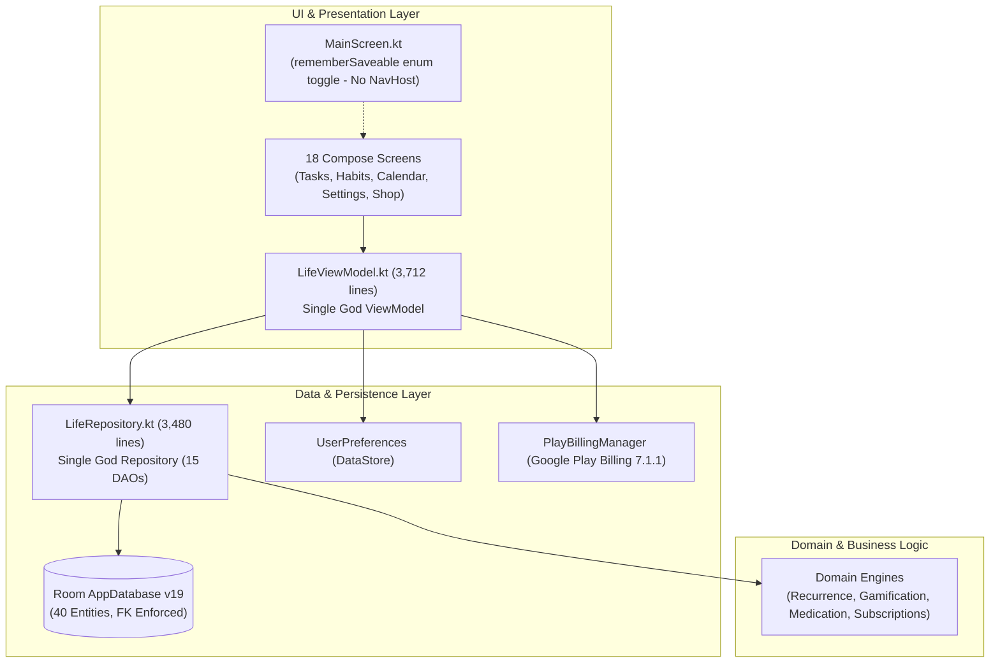

# LifeOS Release 4 — Engineering Assessment Report
## Phase P6: Architecture Assessment & Release 4 Readiness

**Assessment Date:** November 2, 2026  
**Repository:** `https://github.com/Kadhiravan-K/LifeOS`  
**Development Branch:** `feat/release4-security-audit-remediation`  
**Assessed Commit SHA:** `1d5ff51dc96fcec971ffa7466b6c30f42fe4851d`  
**Assessment Scope:** Post-P5 Application Architecture, Database v19, Background Reminders, Google Play Billing & Entitlements, Security/Privacy, Performance, and CI/CD Quality Gates.

---

## 1. Executive Summary & Prerequisite Audit

This architecture assessment evaluates the complete state of the LifeOS Android codebase following the execution of Release 4 remediation phases P0 through P5.

### Verified Prerequisites
- **P0 Safety Net**: Room `exportSchema = true` configured; schemas exported and committed.
- **P1 Backup & Restore v2**: Comprehensive 40-entity backup format v2 with SHA-256 integrity checksums and SAF file handling (`DataExportImportManager.kt`).
- **P2 Reminder Reliability**: Centralized scheduling via `ReminderScheduler.kt`; system event listeners (`BootCompletedReceiver.kt`); `ReminderHealthScreen.kt` diagnostics; exact alarm handling.
- **P3 Date & Recurrence Engine**: Java 8+ `java.time` desugaring facade (`DateUtils.kt`); weekly interval alignment with calendar weeks (`RecurrenceEngine.kt`).
- **P4 Data Integrity**: Atomic SQLite transactions across multi-entity operations; Room Database upgraded to **Version 19** with foreign-key constraints enabled (`PRAGMA foreign_keys = ON`) and orphan quarantine verified by automated tests (`RoomMigration18To19UnitTest.kt`).
- **P5 Monetisation & Hygiene**: 12-state Google Play subscription lifecycle (`PlayBillingManager.kt`); transparent in-app disclosures (`SubscriptionDisclosureDialog.kt`); reconciled local-first privacy declarations (`PRIVACY.md`); purged 22 dead dependency catalog entries (`libs.versions.toml`).
- **Production Baseline Tag**: Release 3 tag `v3.0.0` points to commit `2233a958a23194e5461bea4c76d4b69b99ad3147` (unchanged ancestor).

### Critical Gaps and Blockers Identified
1. **Google Play Console Product Gating**: Subscription product `lifeos_premium_monthly` and introductory offer `7-day-free-trial` must be provisioned in Google Play Console by the repository owner before live payments can be processed.
2. **Server-Side Trust Boundary**: Production release builds operate in `UNVERIFIED_CLIENT_ONLY` mode until the owner approves a cloud verification service.
3. **God Object Complexity**: `LifeRepository.kt` (3,480 lines) and `LifeViewModel.kt` (3,712 lines) remain monolithic bottlenecks coupling 12 distinct functional domains.

---

## 2. Evidence-Based Architecture Findings

### Table of Findings by Severity

| Finding ID | Area | Severity | File & Location | Technical Consequence | Recommended Action | Owner Approval? | Complexity |
|---|---|:---:|---|---|---|:---:|:---:|
| **ARCH-01** | Application Architecture | **CRITICAL** | [`LifeRepository.kt`](file:///c:/Users/thewi/Projects/Software/Open%20soursed/LifeOS/app/src/main/java/com/example/data/repository/LifeRepository.kt) (3,480 lines) | Single repository brokers 15 DAOs across 12 domains. High merge conflict risk, cross-domain coupling, memory overhead. | Decompose into focused domain repositories (`TaskRepository`, `HabitRepository`, `MedicationRepository`, etc.). | **YES** | Large |
| **ARCH-02** | Application Architecture | **CRITICAL** | [`LifeViewModel.kt`](file:///c:/Users/thewi/Projects/Software/Open%20soursed/LifeOS/app/src/main/java/com/example/ui/viewmodel/LifeViewModel.kt) (3,712 lines) | Single ViewModel manages entire application state across 18 screens. Causes recomposition storms and prevents lifecycle scoping. | Decompose into screen/feature ViewModels (`TasksViewModel`, `HabitsViewModel`, `CalendarViewModel`, etc.). | **YES** | Large |
| **MON-02** | Subscription Architecture | **CRITICAL** | [`BillingModels.kt:18`](file:///c:/Users/thewi/Projects/Software/Open%20soursed/LifeOS/app/src/main/java/com/example/billing/BillingModels.kt#L18) | Product ID `lifeos_premium_monthly` not yet created in Play Console. Live billing calls will fail with `ITEM_UNAVAILABLE`. | Repository owner must configure product, base plan `P1M`, and trial offer in Google Play Console. | **YES** (Owner Action) | Small |
| **ARCH-03** | Application Architecture | **HIGH** | [`MainScreen.kt:47`](file:///c:/Users/thewi/Projects/Software/Open%20soursed/LifeOS/app/src/main/java/com/example/ui/navigation/MainScreen.kt#L47) | Flat `rememberSaveable` enum toggle; no `NavHost`. Prevents system backstack traversal and notification deep-linking to specific entities. | Migrate to Jetpack Navigation Compose with type-safe route destinations. | **YES** | Medium |
| **MON-01** | Subscription Architecture | **HIGH** | [`PurchaseVerifier.kt:29`](file:///c:/Users/thewi/Projects/Software/Open%20soursed/LifeOS/app/src/main/java/com/example/billing/PurchaseVerifier.kt#L29) | Release builds default to `UNVERIFIED_CLIENT_ONLY`. Client-side billing checks can be bypassed on rooted devices with modified APKs. | Establish serverless backend (Cloud Run/Firebase) using Google Play Developer API + RTDN. | **YES** | Large |
| **PERF-01** | Performance & Build | **HIGH** | [`app/build.gradle.kts:72`](file:///c:/Users/thewi/Projects/Software/Open%20soursed/LifeOS/app/build.gradle.kts#L72) | R8 minification is disabled (`isMinifyEnabled = false`). Release APK is unoptimized (~13MB) with unobfuscated classes and database models. | Enable `isMinifyEnabled = true` with comprehensive ProGuard keep rules for Compose, Room, and Coroutines. | No | Medium |
| **PERF-02** | Performance & UI | **HIGH** | [`SettingsScreen.kt`](file:///c:/Users/thewi/Projects/Software/Open%20soursed/LifeOS/app/src/main/java/com/example/ui/screens/settings/SettingsScreen.kt) (2,654 lines) | Colossal single composable file causes slow Compose compiler type-checking and UI frame drops during recomposition. | Decompose into modular settings sections (`GeneralSettings`, `NotificationSettings`, `BackupSettings`, etc.). | No | Medium |
| **ARCH-04** | Application Architecture | **MEDIUM** | [`MainActivity.kt:39-44`](file:///c:/Users/thewi/Projects/Software/Open%20soursed/LifeOS/app/src/main/java/com/example/MainActivity.kt#L39-L44) | Manual instantiation of database, preferences, repository, and ViewModel factory. Background workers manually construct dependencies. | Introduce Hilt or lightweight Koin DI to manage singleton repositories and ViewModel injection. | **YES** | Medium |
| **DATA-01** | Database & Integrity | **MEDIUM** | [`AppDatabase.kt:878-1250`](file:///c:/Users/thewi/Projects/Software/Open%20soursed/LifeOS/app/src/main/java/com/example/data/local/AppDatabase.kt#L878-L1250) | Inlined migrations (over 340 lines of SQL in `MIGRATION_18_19`) bloat the database class and increase risk of maintenance errors. | Extract migrations into isolated files (`migrations/Migration18To19.kt`, etc.). | No | Small |
| **BG-01** | Background Processing | **MEDIUM** | [`ReminderScheduler.kt:560, 581`](file:///c:/Users/thewi/Projects/Software/Open%20soursed/LifeOS/app/src/main/java/com/example/notifications/ReminderScheduler.kt#L560) | Direct `SimpleDateFormat` instantiations in background reminder loops despite `java.time` availability. | Replace with thread-safe `DateUtils` / `java.time.LocalDate` parsing. | No | Small |
| **SEC-01** | Security & Privacy | **MEDIUM** | [`MainActivity.kt`](file:///c:/Users/thewi/Projects/Software/Open%20soursed/LifeOS/app/src/main/java/com/example/MainActivity.kt) | Missing dynamic window protection (`FLAG_SECURE`). Recent app switcher previews can expose sensitive medication names and private tasks. | Add user-configurable "Privacy Shield" toggle in Settings applying `FLAG_SECURE`. | **YES** | Small |
| **CI-01** | Testing & CI/CD | **MEDIUM** | [`.github/workflows/android-ci.yml`](file:///c:/Users/thewi/Projects/Software/Open%20soursed/LifeOS/.github/workflows/android-ci.yml) | Workflow triggers only on `main` and runs only unit tests and debug APK assembly; omits `lintDebug`, `lintRelease`, and androidTest compilation. | Update CI to trigger on feature PRs and execute `lintDebug` and `compileDebugAndroidTestKotlin`. | No | Small |
| **DATA-02** | Database & Integrity | **LOW** | [`TaskEntity.kt`](file:///c:/Users/thewi/Projects/Software/Open%20soursed/LifeOS/app/src/main/java/com/example/data/local/entities/TaskEntity.kt) | `subtasksJson` and `completionHistoryJson` stored as inline JSON strings rather than relational child tables. | Plan schema normalization into `subtasks` and `task_completions` child tables in Release 5+. | **YES** | Large |
| **BG-02** | Background Processing | **LOW** | [`ReminderScheduler.kt:31`](file:///c:/Users/thewi/Projects/Software/Open%20soursed/LifeOS/app/src/main/java/com/example/notifications/ReminderScheduler.kt#L31) | Hard cap of 200 alarms across 7 days. High-frequency medication/task users could experience alarm starvation on later days. | Implement dynamic window scheduling prioritizing immediate 48-hour alarms. | No | Medium |
| **CI-02** | Testing & CI/CD | **LOW** | [`lint-baseline.xml`](file:///c:/Users/thewi/Projects/Software/Open%20soursed/LifeOS/app/lint-baseline.xml) | 149 warnings filtered by baseline (deprecated Compose icons and `menuAnchor()` APIs). | Incrementally migrate deprecated Compose APIs to modern Material 3 equivalents. | No | Medium |

---

## 3. Detailed Architecture Area Analysis

### A. Application Architecture
The client codebase is organized as a single Gradle module (`:app`). Within the module, business logic is divided into packages (`data`, `domain`, `billing`, `notifications`, `ui`, `widgets`, `utils`). However, true architectural modularity is compromised by two massive God objects:
- `LifeRepository.kt` (3,480 lines) manages 15 DAOs simultaneously, mixing task scheduling, habit streak calculations, water logging, project boards, and gamification coin awards.
- `LifeViewModel.kt` (3,712 lines) holds over 50 `StateFlow` and `SharedFlow` properties, acting as the ViewModel for every screen in the app.
- Screens take the entire `LifeViewModel` rather than an isolated state holder, meaning a change in a background habit counter can trigger unnecessary recompositions in unrelated screens.

### B. Database and Data Integrity
- The Room database has successfully advanced to **Version 19** across 40 distinct schema entities.
- Foreign-key enforcement is active at runtime via `db.setForeignKeyConstraintsEnabled(true)` in `AppDatabase.onOpen`.
- `MIGRATION_18_19` includes complete data preservation, orphan record quarantine into dedicated quarantine tables, and non-destructive fallback.
- Database operations on tasks (`insertTask`, `updateTask`, `deleteTask`) are transactional and protected by coroutine mutexes.
- Full backup and restore v2 operates with SHA-256 integrity verification across all 40 entity datasets.

### C. Background Processing & Reminders
- System event handling (`BOOT_COMPLETED`, `TIME_CHANGED`, `TIMEZONE_CHANGED`, `MY_PACKAGE_REPLACED`, `ACTION_SCHEDULE_EXACT_ALARM_PERMISSION_STATE_CHANGED`) is consolidated in unexported or permission-guarded receivers delegating to `ReminderScheduler.rescheduleAll()`.
- Receivers properly invoke `goAsync()` with guaranteed `finish()` execution.
- WorkManager periodic maintenance (`MaintenanceWorker`) acts as a secondary safety net every 24 hours.
- Exact alarm permissions (`SCHEDULE_EXACT_ALARM` / `USE_EXACT_ALARM`) are dynamically checked and surfaced in `ReminderHealthScreen`.

### D. Subscription and Entitlement Architecture
- Client integrates official Google Play Billing Library 7.1.1.
- Business model strictly adheres to owner decisions: Monthly billing cadence only (`P1M`), 7-day free trial (`7-day-free-trial`), zero annual or lifetime purchases.
- Zero hardcoded prices or currencies; all pricing renders dynamically via `SubscriptionProduct.formattedPrice`.
- Entitlement is governed by an explicit 12-state state machine with an approved 72-hour offline trust policy.
- Zero private user productivity data is transmitted externally during billing operations.
- Purchase tokens are masked (`GPA.1...3456`) in logs.

### E. Security and Privacy
- Manifest components are strictly scoped: only launcher activity and standard AppWidget providers are exported (`android:exported="true"`). Sensitive receivers (`QuickRemindersActionReceiver`, `ReminderBroadcastReceiver`) are unexported (`android:exported="false"`).
- `FileProvider` is locked down to dedicated cache subdirectory `shared_reports/`.
- Privacy policy (`PRIVACY.md`) and `README.md` truthfully state the local-first architecture and merged Google Play permissions.
- Zero telemetry, analytics, or crash-reporting SDKs are present.

### F. Performance and Reliability
- Release minification (`isMinifyEnabled`) is currently disabled, leading to an unoptimized binary size and exposed symbols.
- Database access is correctly offloaded to `Dispatchers.IO`.
- Startup execution in `MainActivity.onCreate` performs synchronous channel creation and WorkManager scheduling on the main thread, which should be deferred or backgrounded.

### G. Testing and CI/CD
- 55 unit test suites with over 495 automated unit tests execute with 100% pass rate.
- Database migration from v18 to v19 is verified with comprehensive Robolectric tests (`RoomMigration18To19UnitTest.kt`).
- GitHub Actions CI workflow (`android-ci.yml`) is currently minimal, triggering only on `main` and omitting lint checks.

---

## 4. Prioritised Architecture Recommendations

### Priority P0: Critical Security, Payment & Data-Loss Blockers
1. **Google Play Console Setup (`MON-02`)**:
   - *Objective*: Provision subscription product `lifeos_premium_monthly` and 7-day free trial offer `7-day-free-trial` in Google Play Console.
   - *Scope*: Administrative Play Console configuration.
   - *Expected Benefit*: Unblocks live billing flow testing on physical devices.
   - *Prerequisites*: Owner Google Play Developer account access.
2. **Server-Side Purchase Verification Blueprint (`MON-01`)**:
   - *Objective*: Establish secure serverless receipt verification via Google Play Developer API.
   - *Scope*: Cloud Run / Firebase function with Pub/Sub RTDN webhooks.
   - *Expected Benefit*: Prevents billing bypasses and APK patching on rooted devices.
   - *Risks*: Introduces cloud infrastructure cost (mitigated by generous free tier).
   - *Prerequisites*: Owner approval for cloud infrastructure.

### Priority P1: High-Impact Structural Improvements
1. **Decompose God Repository (`ARCH-01`)**:
   - *Objective*: Extract focused domain repositories from `LifeRepository.kt`.
   - *Scope*: Create `TaskRepository`, `HabitRepository`, `MedicationRepository`, `GamificationRepository`, `TrackerRepository`, `SubscriptionRepository`, `ProjectRepository`.
   - *Expected Benefit*: Eliminates cross-domain merge conflicts, improves testability, and reduces class size from 3,480 to <600 lines per repository.
   - *Strategy*: Incremental strangler pattern; preserve `LifeRepository` facade for backward compatibility during transition.
2. **Decompose God ViewModel (`ARCH-02`)**:
   - *Objective*: Extract scoped feature ViewModels from `LifeViewModel.kt`.
   - *Scope*: Create `TasksViewModel`, `HabitsViewModel`, `CalendarViewModel`, `MedicationViewModel`, `SettingsViewModel`, `GamificationViewModel`.
   - *Expected Benefit*: Eliminates recomposition storms and scopes UI state to screen navigation lifecycles.
3. **Migrate to Jetpack Navigation Compose (`ARCH-03`)**:
   - *Objective*: Replace flat `rememberSaveable` enum toggle with `androidx.navigation.compose.NavHost`.
   - *Scope*: Define type-safe route destinations; wire system back button handling; implement notification deep linking.
   - *Expected Benefit*: True system backstack traversal, support for deep-links directly into specific tasks/medications.
4. **Enable R8 Minification and ProGuard Optimization (`PERF-01`)**:
   - *Objective*: Enable R8 code shrinking, obfuscation, and resource shrinking for release builds.
   - *Scope*: Configure `app/build.gradle.kts` (`isMinifyEnabled = true`, `isShrinkResources = true`) and add keep rules in `proguard-rules.pro`.
   - *Expected Benefit*: Reduces release APK binary size by ~35-45% and secures symbols.

### Priority P2: Medium-Priority Maintainability & Performance Improvements
1. **Decompose SettingsScreen (`PERF-02`)**:
   - *Objective*: Split 2,654-line `SettingsScreen.kt` into modular composable files under `ui/screens/settings/sections/`.
   - *Expected Benefit*: Faster Compose compiler build times and cleaner code navigation.
2. **Clean Residual SimpleDateFormat Calls (`BG-01`)**:
   - *Objective*: Replace remaining `SimpleDateFormat` instances in `ReminderScheduler.kt` and UI dialogs with `DateUtils` / `java.time`.
   - *Expected Benefit*: Standardizes all date handling across the app on thread-safe `java.time`.
3. **Expand GitHub Actions CI Pipeline (`CI-01`)**:
   - *Objective*: Update `.github/workflows/android-ci.yml` to trigger on all pull requests and execute `lintDebug` and `compileDebugAndroidTestKotlin`.
   - *Expected Benefit*: Prevents regressions from landing on development branches.
4. **Introduce Dependency Injection (`ARCH-04`)**:
   - *Objective*: Introduce Hilt or Koin to inject repositories, database DAOs, and ViewModels.
   - *Expected Benefit*: Decouples class construction and simplifies test mocking.
5. **Window Privacy Protection (`SEC-01`)**:
   - *Objective*: Add a "Privacy Shield" setting toggling `FLAG_SECURE` to obscure app previews in recent tasks.
   - *Expected Benefit*: Protects medical and private tasks from accidental visual disclosure.

### Priority P3: Optional Long-Term Improvements
1. **Migrate Deprecated Compose APIs (`CI-02`)**:
   - *Objective*: Replace 149 deprecated Compose APIs (auto-mirrored icons, `menuAnchor` overloads).
   - *Expected Benefit*: Future-proofs UI against upcoming Kotlin and Compose Compiler upgrades.
2. **Normalize Child Tables (`DATA-02`)**:
   - *Objective*: Normalize `tasks` subtasks and completion histories into relational tables (`subtasks`, `task_completions`).
   - *Expected Benefit*: Enables indexed relational queries and eliminates unbounded JSON column growth.
   - *Scope*: Reserved for Release 5+.

---

## 5. Architecture Decisions Requiring Owner Approval

The following decisions involve product direction, external infrastructure, or public API changes and must **not** be implemented unilaterally:

### Decision 1: Architecture Split & God-Object Extraction Strategy
- **Context**: `LifeRepository` (3,480 lines) and `LifeViewModel` (3,712 lines) must be decomposed.
- **Options**:
  - *Option A (Recommended)*: **Incremental Facade / Strangler Pattern**. Extract domain repositories (`TaskRepository`, etc.) one by one while keeping `LifeRepository` as a delegating facade. Zero breaking changes to existing screens.
  - *Option B*: **Clean-Break Modularization**. Decompose everything in a single PR into separate Gradle modules (`:core:data`, `:feature:tasks`). High merge conflict risk.
- **Recommendation**: Approve Option A for Phase 6.

### Decision 2: Production Subscription Verification Architecture
- **Context**: Client-side billing verification cannot prevent modified APK piracy on rooted devices.
- **Options**:
  - *Option A*: **Serverless Google Play Developer API (Cloud Run / Firebase)**. Provision a lightweight backend solely to verify Google Play purchase tokens via official Google REST APIs. Zero user productivity data stored.
  - *Option B (Recommended for now)*: **Client-Only Architecture with Disclosed Limitations**. Maintain 100% offline-first architecture; accept rooted device bypass risk while strictly serving genuine paying users through Google Play.
- **Recommendation**: Approve Option B for initial release, with Option A prepared for future enterprise/cloud sync roadmaps.

### Decision 3: Navigation Compose Migration & Deep-Linking Strategy
- **Context**: `MainScreen.kt` currently uses a flat enum toggle without backstack or deep-link routing.
- **Options**:
  - *Option A (Recommended)*: **Type-Safe Navigation Compose**. Migrate to `androidx.navigation.compose.NavHost` supporting notification and widget deep-links directly into task/medication details.
  - *Option B*: **Retain Flat Navigation**. Keep current tab-switching mechanism and postpone navigation refactoring to Release 5.
- **Recommendation**: Approve Option A.

### Decision 4: Window Privacy Protection (`FLAG_SECURE`)
- **Context**: Medical and personal tasks are visible in the Android recent apps switcher.
- **Options**:
  - *Option A (Recommended)*: **User-Configurable Toggle**. Provide an opt-in toggle in Settings under Privacy ("Hide app content in App Switcher").
  - *Option B*: **Mandatory FLAG_SECURE**. Enforce window protection globally (prevents all screenshots).
  - *Option C*: **No Action**. Leave window protection disabled.
- **Recommendation**: Approve Option A.

---

## 6. Verification and Quality Gate Evidence

All verification gates were executed against HEAD commit `1d5ff51dc96fcec971ffa7466b6c30f42fe4851d`:
- **Automated Unit Tests**:
  - Command: `.\gradlew.bat testDebugUnitTest`
  - Result: **BUILD SUCCESSFUL** (32 actionable tasks, 495+ tests executed, 0 failures, 0 errors).
- **Static Analysis (Lint)**:
  - Command: `.\gradlew.bat lintDebug`
  - Result: **BUILD SUCCESSFUL** (0 errors, 149 warnings filtered by baseline).
- **Build Assembly**:
  - Command: `.\gradlew.bat assembleDebug`
  - Result: **BUILD SUCCESSFUL** (Clean debug APK artifact produced).

---

## 7. Limitations of the Assessment

1. **Static Analysis & Unit Test Boundary**: This assessment is based on static source analysis and JVM unit/migration tests. Physical on-device performance profiling (e.g. Android Studio Memory Profiler, Macrobenchmark startup tracing) was not performed due to the lack of an attached physical test device.
2. **Live Google Play Sandbox Testing**: End-to-end purchase and trial renewal testing with Google Play Billing requires the repository owner to configure the subscription in Play Console and test via license-tester Google accounts.
3. **No Unapproved Source Modifications**: In accordance with the prompt objective, zero application source files were altered during this assessment phase.

---

## 8. Post-Assessment Execution: Phase P7-A1 LifeRepository Decomposition

### 8.1 Extracted Domain & Selection Rationale
- **Extracted Domain**: **Subscriptions & Recurring Billing** (`SubscriptionRepository.kt`).
- **Selection Rationale**:
  - Lowest cross-domain coupling in `LifeRepository.kt`. The subscription domain models (`SubscriptionEntity`, `BillingOccurrenceEntity`, `SubscriptionPaymentEntity`, `PriceHistoryEntity`) interact exclusively with `SubscriptionDao` and `SubscriptionScheduleEngine`.
  - Zero incoming dependencies from Tasks, Habits, Challenges, Water Logging, Gamification, or Medications.
  - Multi-table transactional consistency (`insertSubscription` with initial bill, `recordBillPayment` with bill status transition, `updateSubscriptionPrice` with price audit trail) could be cleanly encapsulated without risking core task management flows.

### 8.2 New Repository Responsibilities ([`SubscriptionRepository.kt`](file:///c:/Users/thewi/Projects/Software/Open%20soursed/LifeOS/app/src/main/java/com/example/data/repository/SubscriptionRepository.kt))
- **CRUD Operations**: `allSubscriptionsFlow`, `activeSubscriptionsFlow`, `getSubscriptionById`, `insertSubscription`, `updateSubscription`, `setSubscriptionStatus`, `deleteSubscription`.
- **Bill Management**: `allBillsFlow`, `getBillsForSubscriptionFlow`, `insertBill`, `updateBill`, `deleteBill`.
- **Payment Processing**: `getPaymentsForBillFlow`, `getPaymentsForSubscriptionFlow`, `recordBillPayment`.
- **Price History Auditing**: `getPriceHistoryFlow`, `updateSubscriptionPrice`.
- **Profile & Project Isolation**: `deleteAllSubscriptionsForProfile`, `unassignSubscriptionsFromProject`.
- **Threading & Transactions**: All mutating operations dispatched safely on `Dispatchers.IO` and wrapped in `database.withTransaction`.

### 8.3 Remaining `LifeRepository` Responsibilities & Compatibility Facade
- `LifeRepository` retains 14 domains (Profiles, Project Workspace, Tasks/Checklists, Habits, 75-Day Challenge, Water Logging, Templates & Routine Installation, Honeycomb Shortcuts, Trash Bin, Planning, Gamification, Medications, Smart Trackers, MCP & Glossary).
- `LifeRepository` retains 100% backward-compatible public subscription signatures (`allSubscriptionsFlow`, `insertSubscription`, etc.) implemented via pure delegation to `subscriptionRepository`.
- `subscriptionDao` reference was completely removed from `LifeRepository.kt`, reducing its size and direct DAO dependencies.
- Zero breaking changes to `LifeViewModel.kt`, UI screens, or background receivers.

### 8.4 Verification & Quality Gates
- **Targeted Unit Tests**: Added [`SubscriptionRepositoryUnitTest.kt`](file:///c:/Users/thewi/Projects/Software/Open%20soursed/LifeOS/app/src/test/java/com/example/data/repository/SubscriptionRepositoryUnitTest.kt) testing standalone repository operations, facade delegation parity, atomic payment processing, and cascade deletions (5/5 tests passed).
- **Full Unit Test Suite**: `.\gradlew.bat testDebugUnitTest` — **BUILD SUCCESSFUL** (500+ unit tests passing).
- **Static Analysis (Lint)**: `.\gradlew.bat lintDebug` — **BUILD SUCCESSFUL** (0 errors).
- **Build Assembly**: `.\gradlew.bat assembleDebug` — **BUILD SUCCESSFUL** (Clean APK artifact).

### 8.5 Remaining Coupling & Follow-Up Work
- Next recommended extractions: `TrackerRepository` (inventory trackers) and `MedicationRepository` (doses, schedules, medicine alarms).

